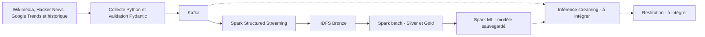

# TrendCast

**Une plateforme académique Big Data pour analyser les tendances et prévoir les vues Wikipédia à J+1.**


> [!IMPORTANT]
> **[Ouvrir la version intégrée et son guide de démonstration](https://github.com/Urgsalman/trendcast-big-data-platform/tree/integration/pre-presentation)**
> La branche d’intégration contient le code utilisé pour la présentation des modules **Big Data Plateformes** et **Big Data Analytics**.

## Architecture



La voie froide archive les événements en Parquet, produit les indicateurs historiques et prépare la régression sur 20 pages technologiques de Wikipédia anglophone. Le cluster Docker associe un Master Spark, deux Workers, un NameNode et deux DataNodes. La réplication HDFS de deux copies a été vérifiée sur les blocs Gold ML et sur le modèle V2.

## État de la démonstration

| Périmètre | État |
|---|---|
| Collecte, validation, automatisation, stockage Bronze et traitements Silver/Gold | Code intégré. Tests unitaires et snapshot Gold documentés. La reprise Kafka–Bronze reste à revalider sur le cluster de présentation. |
| Modèle V2 Spark ML | Rechargé depuis HDFS. Le replay historique a produit 20 prévisions avec un exécuteur sur chacun des deux Workers. |
| Candidat J−1 | Résultats expérimentaux avec disponibilité simulée. Il reste à vérifier localement le paquet binaire. |
| Inférence Kafka, base de restitution et dashboard | Intégration à réaliser. |

Les dates de réception utilisées dans le replay sont simulées. Le guide d’intégration détaille les résultats, la provenance des données, la conformité académique et les contributions de Soulaimane, Zakaria, Hala et le périmètre prévu pour Nadir.

## Accéder au code et lancer la démonstration

Récupérer la branche d’intégration avant d’exécuter les commandes du guide.

```powershell
git clone --branch integration/pre-presentation https://github.com/Urgsalman/trendcast-big-data-platform.git
Set-Location trendcast-big-data-platform
```

- [Installation et reconstruction](https://github.com/Urgsalman/trendcast-big-data-platform/tree/integration/pre-presentation#installation-et-reproductibilité)
- [Commandes de démonstration](https://github.com/Urgsalman/trendcast-big-data-platform/tree/integration/pre-presentation#démonstration)
- [Ingestion et automatisation](https://github.com/Urgsalman/trendcast-big-data-platform/blob/integration/pre-presentation/ingestion/README_AUTOMATION.md)
- [Cluster Spark et HDFS](https://github.com/Urgsalman/trendcast-big-data-platform/blob/integration/pre-presentation/storage/README.md)
- [Modèles, résultats et passation](https://github.com/Urgsalman/trendcast-big-data-platform/blob/integration/pre-presentation/analytics/ml/README.md)
