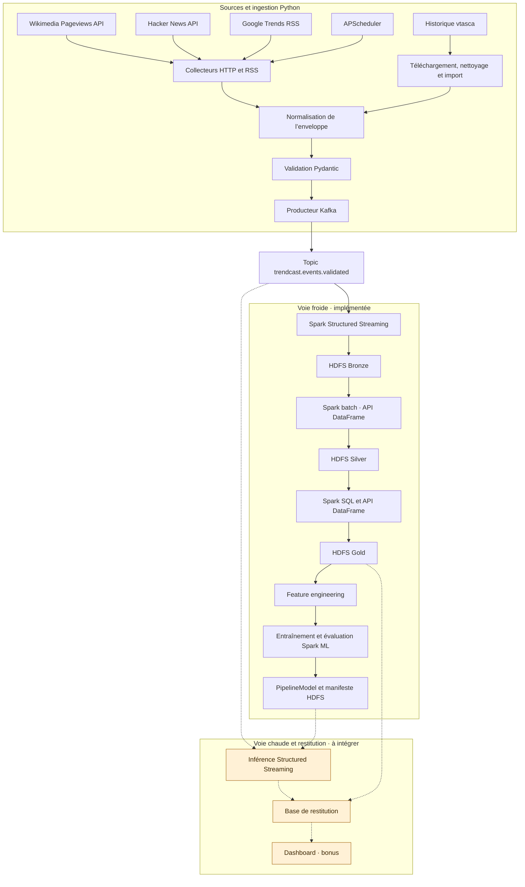
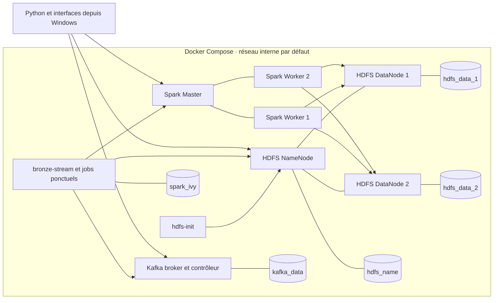
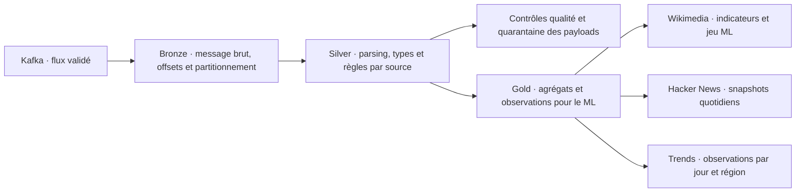
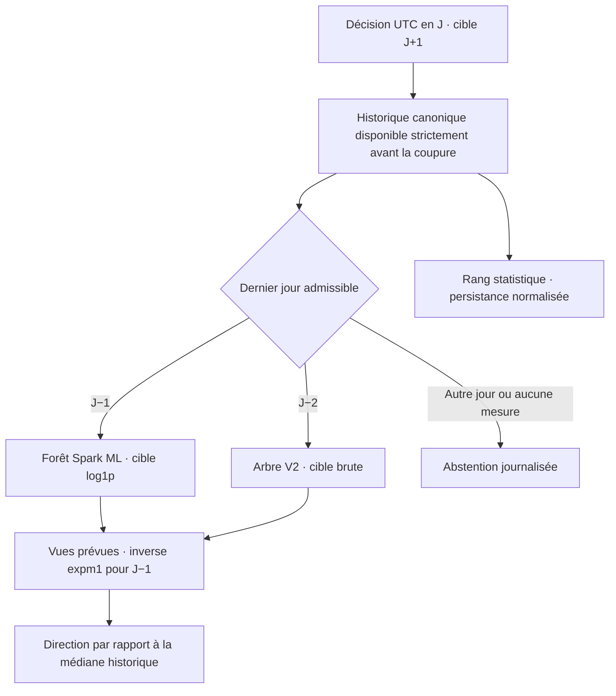

# TrendCast

**Des événements web aux indicateurs distribués et à la prévision des vues Wikipédia à J+1.**


Projet académique des modules **Big Data Plateformes** et **Big Data Analytics**. TrendCast collecte des signaux d’intérêt, archive les événements et calcule des indicateurs historiques. La tâche de régression prévoit les vues du lendemain pour 20 pages technologiques de Wikipédia anglophone. Le corpus historique général couvre aussi d’autres thèmes. Kafka découple la collecte du traitement, Spark distribue les calculs et HDFS répartit les blocs de données.

> [!IMPORTANT]
> La V2 sauvegardée a été chargée sur Spark distribué et a produit 20 prévisions en replay historique. La politique J−1 reste expérimentale. La voie chaude Kafka, la base de restitution et le dashboard restent à intégrer.

## Sommaire

- [Architecture globale](#architecture-globale) · [Cluster Docker](#cluster-docker)
- [Sources de données](#sources-de-données) · [Ingestion et Kafka](#ingestion-et-kafka) · [Automatisation](#automatisation)
- [Architecture Medallion](#architecture-medallion) · [Volumétrie et qualité](#volumétrie-et-qualité)
- [Analytics et Machine Learning](#analytics-et-machine-learning) · [Stratégies de prédiction](#stratégies-de-prédiction)
- [Stack technologique](#stack-technologique) · [Organisation du dépôt](#organisation-du-dépôt)
- [Installation et reproductibilité](#installation-et-reproductibilité) · [Démonstration](#démonstration)
- [Contributions](#contributions) · [Conformité académique](#conformité-académique) · [Limites et perspectives](#limites-et-perspectives)

## Architecture globale



Chaque événement normalisé passe par Pydantic avant publication. Spark consomme Kafka et conserve en Bronze le message source et ses coordonnées. Les traitements batch produisent ensuite les données typées et contrôlées de Silver puis les indicateurs et le jeu ML de Gold. La prévision future doit lire Kafka et charger les modèles sauvegardés, avec un historique durable des mesures disponibles à la décision. Les flèches pointillées représentent les intégrations prévues.

## Cluster Docker



| Service | Adresse interne | Accès hôte et rôle |
|---|---|---|
| Broker Kafka | `kafka:29092`, contrôleur KRaft `:9093` | Producteurs Windows sur `localhost:9092`. |
| Spark Master | `spark://spark-master:7077` | [Interface Spark](http://localhost:8080). Le Master reçoit les applications et alloue des exécuteurs. |
| Workers Spark | `spark-worker-1:8081`, `spark-worker-2:8081` pour leurs interfaces internes | Un cœur alloué par Worker dans Compose. Les exécuteurs traitent les partitions. |
| NameNode | `hdfs://namenode:9000` | [Interface HDFS](http://localhost:9870). Il gère l’espace de noms et la localisation des blocs. |
| DataNodes | `datanode-1:9866`, `datanode-2:9866` | Stockent et servent les blocs. |
| Initialisation et jobs | `hdfs-init`, `bronze-stream`, `bronze` (profil `jobs`) | Initialisation des chemins, streaming continu et soumissions ponctuelles. |

Les exécuteurs obtiennent les emplacements auprès du NameNode et lisent les blocs sur les DataNodes. Le calcul Spark et le stockage HDFS sont distribués séparément. La réplication HDFS de **2** conserve deux copies des blocs sur les DataNodes. Les volumes distincts persistent après un redémarrage de conteneur. Le broker Kafka unique a son propre volume et une réplication Kafka de **1** dans ce cluster pédagogique. [Configuration Compose](docker-compose.yml) · [Configuration HDFS](infra/hadoop/hdfs-site.xml)

## Sources de données

| Source | Type | Données | Fréquence par défaut | Usage |
|---|---|---|---|---|
| Wikimedia Pageviews | REST par article | Projet, titre, jour UTC, vues | Observation quotidienne, collecte toutes les 24 h | Séries de vues et régression |
| Hacker News | API Firebase | Article, score, nombre de commentaires, date de publication | Snapshot toutes les 30 min | Indicateurs d’activité |
| Google Trends | RSS à région configurable | Titre, région, trafic approximatif, URL, date RSS | Snapshot toutes les 60 min | Tendances descriptives, Maroc dans le snapshot audité |
| Historique vtasca | Corpus tabulaire | `rank`, `article`, `views`, `date` | Import ponctuel | Extension de la profondeur historique |

L’historique [vtasca/wikipedia-pageviews](https://huggingface.co/datasets/vtasca/wikipedia-pageviews) agrège les pages les plus consultées de Wikipédia anglophone via l’endpoint Wikimedia `top/en.wikipedia/all-access`. Le script lit le split `train` et écrit le Parquet brut local. Le nettoyage filtre les titres vides, dates invalides, vues négatives et rangs invalides, puis déduplique par article et date. Les lignes deviennent des événements Wikimedia validés et passent par Kafka. Le fichier nettoyé audité comptait **396 693 lignes**, du **1er janvier 2016 au 21 novembre 2026**. La révision amont de cet export n’a pas été figée dans le script.

Les données de l’API Wikimedia sont publiées sous CC0 1.0. La fiche du miroir affiche `cc` sans variante précise. La révision et les conditions de redistribution du snapshot restent à documenter avant une nouvelle diffusion. Le top quotidien sélectionne les pages selon leur popularité. L’API TrendCast suit un panel et applique le filtre `user`. L’absence d’un titre du top ne vaut pas zéro. Les trois sources restent séparées car une vue, un score d’article et un terme tendance ont des unités et des rythmes différents. [Collecteur amont](https://github.com/vtasca/wikipedia-pageviews/blob/master/fetcher.py) · [Politique Wikimedia](https://doc.wikimedia.org/generated-data-platform/aqs/analytics-api/documentation/access-policy.html)

## Ingestion et Kafka

Les collecteurs utilisent des timeouts HTTP, des retries avec backoff pour les limitations et erreurs transitoires, et des traitements partiels lorsque des éléments d’un lot sont indisponibles. La normalisation produit une enveloppe commune et un payload typé par source. Exemple conforme au validateur Pydantic :

```json
{
  "event_id": "en.wikipedia:Python_(programming_language):2026112200",
  "source": "wikimedia_pageviews",
  "timestamp": "2026-11-22T00:00:00Z",
  "schema_version": "1.0",
  "payload": {
    "project": "en.wikipedia",
    "page_title": "Python_(programming_language)",
    "granularity": "daily",
    "views": 1234
  }
}
```

| Champ | Signification |
|---|---|
| `event_id` | Identité métier. Pour Wikimedia, projet, titre et jour. |
| `source` | `wikimedia_pageviews`, `hackernews` ou `google_trends`. |
| `timestamp` | Date source UTC normalisée. Son sens dépend de la source. |
| `schema_version` | Version de l’enveloppe, actuellement `1.0`. |
| `payload` | Mesures et attributs propres à la source, contrôlés par Pydantic. |

Le producteur publie dans `trendcast.events.validated`, configuré pour **3 partitions**, avec `acks=all` et attente de l’ACK Kafka. Le registre local aide à prévenir les republications. Un ACK et son reçu SQLite restent deux opérations distinctes. Le [validateur Pydantic](ingestion/validators/event_validator.py) décrit le contrat courant. Le JSON Schema plat sous `config/schemas/` correspond à une version historique.

## Automatisation

[APScheduler](ingestion/run_automation.py) déclenche les collectes au démarrage puis selon les fréquences de la section Sources. Pour Wikimedia, il mémorise le début de série et recherche les jours sans reçu afin de rattraper les trous. Les reçus sont persistés dans SQLite après l’ACK, par destination Kafka. Les snapshots Hacker News et Trends utilisent un créneau pour distinguer les observations successives. La CLI manuelle sert aux collectes ciblées et l’import historique traite le Parquet nettoyé. Ces deux modes partagent un registre distinct de celui de l’automatisation. Un arrêt entre ACK et reçu ou deux processus concurrents peuvent produire des répétitions. Le checkpoint Spark gère la progression du flux, indépendamment de l’identité métier. [Guide d’automatisation](ingestion/README_AUTOMATION.md)

## Architecture Medallion



- **Bronze** conserve le message brut, le JSON, les coordonnées Kafka, `event_timestamp` et `kafka_timestamp`. Le job Spark écrit en append Parquet, partitionne par source et jour d’ingestion, et conserve les enveloppes invalides sous `__invalid__`. Le checkpoint permet la reprise à partir des offsets enregistrés, sous réserve de rétention Kafka. [Job Bronze](storage/kafka_to_bronze.py)
- **Silver** sépare les sources, parse les payloads, type les colonnes et trace les rejets de payload. Les coordonnées Kafka restent disponibles. Les contrôles recherchent notamment les nulls, les valeurs négatives et les coordonnées répétées. Les lignes valides sont conservées pour préserver les snapshots. [Transformation Silver](processing/bronze_to_silver.py) · [Contrôles qualité](processing/silver_quality_checks.py)
- **Gold** agrège les vues Wikimedia par jour et projet, prépare une projection page-jour destinée au ML et agrège les snapshots par jour Kafka, avec la région pour Trends. La somme des compteurs de commentaires Hacker News porte sur les observations. Un même article peut figurer dans plusieurs snapshots. [Construction Gold](analytics/build_gold.py)

Parquet réduit les lectures inutiles grâce à son format colonne et conserve les types. HDFS répartit les blocs et permet la réplication des fichiers consommés par Spark.

```text
/trendcast/
├── raw/events/                         Bronze Parquet
├── processed/
│   ├── wikimedia_pageviews/
│   ├── hackernews/
│   ├── google_trends/
│   └── quarantine/                    selon les rejets
├── analytics/
│   ├── daily_metrics/
│   ├── ml_dataset/
│   ├── hackernews_metrics/
│   ├── google_trends_metrics/
│   └── wikimedia_supervised/           après préparation ML
├── checkpoints/streaming/bronze-events/
└── models/wikimedia_next_day_views/
    ├── hala-20261125-v2/                modèle vérifié
    └── candidates/                     après import du paquet candidat
```

## Volumétrie et qualité

| Dataset | Lignes | Périmètre de mesure |
|---|---:|---|
| Bronze | 463 504 | Exécution historique rapportée par l’équipe |
| Silver Wikimedia | 462 056 | Exécution historique rapportée |
| Silver Hacker News | 1 408 | Exécution historique rapportée |
| Silver Google Trends | 40 | Exécution historique rapportée |
| Gold `daily_metrics` | 3 977 | Snapshot local vérifié |
| Gold `ml_dataset` | 462 056 | Snapshot local vérifié |
| Gold `hackernews_metrics` | 2 | Snapshot local vérifié |
| Gold `google_trends_metrics` | 2 | Snapshot local vérifié |

Le Gold Wikimedia contrôlé couvre **56 758 titres**, **3 977 jours distincts**, du **1er janvier 2016 au 23 novembre 2026**, avec zéro clé projet–page–jour dupliquée, zéro null et zéro vue négative. Lors du contrôle du 26 novembre, `fsck` a confirmé deux DataNodes et deux répliques par bloc, sans bloc manquant ni corrompu pour le Gold ML et la V2.

Une position `(topic, partition, offset)` répétée indique une duplication de transport dans l’archive étudiée. Un même `event_id` peut désigner des snapshots métier successifs. Le contrôle de contenu doit intégrer le payload et le moment d’observation. `event_date` désigne le jour mesuré, `kafka_timestamp` l’horodatage du record et `available_at` la première disponibilité durable d’une version. Le Gold actuel conserve les deux premiers. L’audit a mesuré **255 écarts de vues** sur des clés communes entre l’historique local nettoyé et le snapshot Gold. La provenance par ligne reste à établir. [Profil et données](analytics/ml/RESULTATS.md)

## Analytics et Machine Learning

La cible est le **total de vues de la même page le jour UTC exact J+1**. La préparation filtre 20 titres de `en.wikipedia` entre le 23 novembre 2025 et le 23 novembre 2026. Elle part de **7 320 observations** et construit **7 260 lignes supervisées** selon le compte rapporté. Les mesures identiques sont consolidées, les clés contradictoires écartées et une cible absente sort de l’évaluation. Les retards sont calendaires. Les essais ajoutent notamment des moyennes et dispersions glissantes, des variations et une saisonnalité. Le modèle sauvegardé conserve quatre entrées, dans l’ordre : `latest_views`, `latest_age`, `weekday_sin`, `weekday_cos`.

Le protocole utilise trois validations chronologiques croissantes de 42 jours. Les transformations apprises sont ajustées dans chaque train, et seuls les labels admissibles avant la coupure entrent dans l’ajustement. Les **1 100 clés du 30 septembre au 23 novembre 2026** constituent une rétrospective déjà examinée. La V2 suppose un recul J−2 pour la disponibilité historique. [Préparation supervisée](analytics/ml/build_supervised_dataset.py) · [Entraînement Spark ML](analytics/ml/train_models.py)

La campagne compare **Linear Regression**, **Decision Tree Regressor**, **Random Forest Regressor** et **GBT Regressor**. Les 42 essais documentés séparent l’ablation de features et les réglages, dont la régularisation, la profondeur, le nombre d’arbres et le sous-échantillonnage. Ils comparent aussi des cibles brute, logarithmique et résiduelle. L’arbre V2 retenu utilise `maxDepth=9`, `minInstancesPerNode=8`, `maxBins=64`, `minInfoGain=25.0` et `seed=345`. Il améliore le critère de sélection sur deux fenêtres sur trois face à V1 réajustée. Le mélange hebdomadaire a un meilleur score moyen mais n’améliore qu’une fenêtre selon ce critère.

| Technique | MAE | RMSE | Contexte |
|---|---:|---:|---|
| Persistance J−2 | 2 823,81 | 12 762,44 | Baseline recalculée, 1 100 clés |
| Hebdomadaire | 2 141,94 | 10 636,73 | Baseline recalculée, mêmes clés |
| Linear Regression | 2 769,33 | 10 891,62 | Campagne V2, résultats Hala |
| Arbre V1 livré | 2 170,20 | 9 557,23 | Résultats Hala |
| Random Forest | 2 228,47 | 9 978,28 | Campagne V2, résultats Hala |
| GBT brut | 2 228,44 | 9 660,18 | Campagne V2, résultats Hala |
| **Arbre V2** | **2 084,00** | **9 310,54** | **−2,7 % MAE et −12,5 % RMSE face à l’hebdomadaire** |
| Mélange hebdomadaire | 1 937,48 | 9 034,32 | Résultats Hala sur la même rétrospective |

La **MAE** est l’écart absolu moyen en vues. La **RMSE** pondère davantage les grandes erreurs. La persistance réutilise la dernière observation éligible. L’hebdomadaire réutilise la valeur de la cible moins sept jours, puis la persistance si elle manque. Les pics et certaines pages très fréquentées restent difficiles à prévoir. [Rapport expérimental et réglages](analytics/ml/RESULTATS.md)

## Stratégies de prédiction



Ce diagramme représente la **politique candidate**. Celle-ci filtre les reçus avant déduplication, exige la clôture du jour mesuré et journalise également les sorties non finies. La V2 autonome peut chercher la dernière observation admissible dans sa fenêtre jusqu’à J−2. Dans la politique candidate, le repli exige J−2 exactement. Le classement est une baseline statistique qui normalise les dernières vues admissibles par la médiane de J−28 à J−2. La direction classe la variation du **volume prédit**, avec une bande stable de ±10 %.

| Scénario candidat simulé | MAE | RMSE | Exactitude directionnelle | F1 macro | P@5 | Couverture |
|---|---:|---:|---:|---:|---:|---:|
| Forêt logarithmique J−1 | 1 776,20 | 9 791,86 | 59,4 % | 0,592 | 49,52 % | 100 % |
| Repli arbre V2 J−2 | 2 030,78 | 10 960,75 | 52,3 % | 0,527 | 42,30 % | 100 % |

Les résultats candidats sont rapportés par Hala sur **2 520 clés**, avec disponibilité simulée. Le F1 macro moyenne les scores F1 des classes de direction. P@5 mesure la proportion de bonnes sélections parmi les cinq premières. La couverture est la fraction du panel ayant reçu une prévision. Quand J−1 et J−2 manquent pour cinq pages, la couverture simulée descend à 75 %. La forêt améliore la MAE simulée d’environ 24,46 % face à la persistance J−1 et 27,84 % face à l’hebdomadaire sur les mêmes clés. La persistance normalisée reste la méthode de classement retenue.

La **V2 active** est un `PipelineModel` Spark natif avec manifeste versionné. Son replay est reproductible sur le cluster de démonstration. Le **paquet candidat**, distribué séparément, contient la forêt J−1, l’arbre J−2, le manifeste et les références de replay. La forêt et ses hyperparamètres n’ont pas été vérifiés localement. Nadir doit conserver l’historique des reçus, charger les modèles au démarrage et déclencher le scoring sur un instantané complet dans `foreachBatch`. La clé de publication doit rendre le rejeu d’une décision idempotent. [Passation V2](analytics/ml/PASSATION_NADIR.md) · [Passation candidate](analytics/ml/PASSATION_CANDIDAT_J1.md) · [Résultats J−1](analytics/ml/RESULTATS_CANDIDAT_J1.md)

## Stack technologique

| Technologie | Version observée ou déclarée | Rôle et justification |
|---|---|---|
| Python | 3.10.11 sur l’hôte, 3.10 dans l’image Spark documentée | Collecte, validation et orchestration commune avec PySpark |
| Apache Kafka | 4.1.0 déclarée et observée dans l’image Docker | Découplage producteur–consommateur et journal partitionné |
| Apache Spark, PySpark, Spark SQL, Structured Streaming, Spark ML | 3.5.7, distribution Scala 2.12 | Calcul batch et streaming, préparation et modèles sauvegardés |
| Apache Hadoop HDFS | 3.4.2 dans l’image du cluster | Répartition et réplication des blocs |
| Apache Parquet | Format colonne | Projection des colonnes, types et compression |
| Pydantic | 2.14.3 épinglée | Contrat d’événements et contrôle des payloads |
| APScheduler | 3.11.2 épinglée | Planification périodique des collectes |
| SQLite | Module standard Python | Persistance locale des reçus entre processus |
| Docker / Docker Compose | Docker 29.1.3 / Compose v2.40.3 observés | Réseau et services reproductibles sur un poste |
| Git / GitHub | Historique et refs vérifiés | Traçabilité, partage et attribution |
| Pytest / Ruff | 9.2.0 / 0.17.4 épinglées | Tests unitaires, lint et formatage ciblé |

## Organisation du dépôt

```text
ingestion/                 Collecteurs, validations, producteurs, CLI et tests
storage/                   Kafka vers Bronze, audit, vérification et tests
processing/                Bronze vers Silver, transformations et contrôles
analytics/                 Construction Gold et agrégats par source
└── ml/
    ├── profile_wikimedia.py
    ├── features.py
    ├── build_supervised_dataset.py
    ├── train_models.py
    ├── predict_sample.py
    ├── candidate.py
    └── tests/             Contrôles Spark et replay
infra/                     Dockerfiles, configuration HDFS et soumission Spark
scripts/                   Téléchargement, nettoyage, import et diagnostics
config/schemas/            Ancien schéma JSON Wikimedia
docker-compose.yml         Services, réseaux, volumes et profil jobs
```

[Ingestion](ingestion/README_AUTOMATION.md) · [Stockage et cluster](storage/README.md) · [Analytics et ML](analytics/ml/README.md)

## Installation et reproductibilité

Prévoir Docker Desktop en mode Linux, Compose v2, Git, PowerShell, Python 3.10 et un accès aux registres d’images et à Maven. Le cluster local requiert assez de mémoire pour Kafka, trois daemons Hadoop, trois daemons Spark et le driver. Les limites de ressources sont dans [Compose](docker-compose.yml). Exemple pour un clone neuf :

```powershell
git clone --branch integration/pre-presentation https://github.com/Urgsalman/trendcast-big-data-platform.git
Set-Location trendcast-big-data-platform
py -3.10 -m venv .venv
$py = '.\.venv\Scripts\python.exe'
& $py -m pip install -r ingestion/requirements-automation.txt -r requirements.txt
if (!(Test-Path .env)) { Copy-Item .env.example .env }
docker compose config -q
docker compose build namenode
docker compose --profile jobs build bronze
docker compose up -d --no-build kafka namenode datanode-1 datanode-2 hdfs-init spark-master spark-worker-1 spark-worker-2
docker compose wait hdfs-init
```

Adapter `.env` aux pages, à la région et aux fréquences. Le premier démarrage d’un environnement neuf initialise HDFS. Sur un cluster partagé, vérifier les montages et utiliser la procédure de reprise du [guide cluster](storage/README.md).

### Scénario 1 · Reconstruction complète sur une destination vierge

Les commandes de publication et d’écriture suivantes sont réservées à un **cluster de reconstruction isolé**, après vérification des destinations, du topic et du registre. Consigner la révision de l’export historique et son empreinte. Le téléchargeur suit actuellement le split `train` sans épingler la révision.

```powershell
docker compose exec -T kafka /opt/kafka/bin/kafka-topics.sh --bootstrap-server kafka:29092 --create --if-not-exists --topic trendcast.events.validated --partitions 3 --replication-factor 1

& $py scripts/download_historical_dataset.py
& $py scripts/clean_historical_dataset.py

$env:KAFKA_TOPIC = 'trendcast.events.validated'
$env:INGESTION_STATE_PATH = ".trendcast/rebuild-$([guid]::NewGuid().ToString('N')).sqlite3"
$env:WIKIMEDIA_DEDUP_MIN_IDS = '0'
& $py -c "from ingestion.run_ingestion import initialize_state; initialize_state()"
& $py scripts/import_historical_to_kafka.py --limit 10
```

Le seuil zéro s’applique uniquement au registre neuf associé au topic neuf. L’import sans `--publish` simule le traitement. Vérifier les compteurs avant de poursuivre. Pour une collecte ciblée, utiliser `& $py -m ingestion.run_ingestion --source wikimedia`. Pour le scheduler, utiliser `& $py -m ingestion.run_automation` dans un second terminal après avoir configuré sa destination. Éviter les collectes concurrentes lors de l’import initial.

```powershell
# Cluster vierge et isolé uniquement
& $py scripts/import_historical_to_kafka.py --publish
& $py -m ingestion.run_ingestion --source hackernews
$env:GOOGLE_TRENDS_GEO = 'MA'
& $py -m ingestion.run_ingestion --source google_trends
docker compose --profile jobs run --rm --no-deps -T bronze --available-now
```

Confirmer la présence des trois sources avec l’audit Bronze avant d’écrire Silver et Gold.

```powershell
docker compose --profile jobs run --rm --no-deps -T -e TRENDCAST_JOB=audit_bronze.py bronze --require-cluster
docker compose --profile jobs run --rm --no-deps -T -e TRENDCAST_JOB=bronze_to_silver.py bronze --write
docker compose --profile jobs run --rm --no-deps -T -e TRENDCAST_JOB=silver_quality_checks.py bronze
docker compose --profile jobs run --rm --no-deps -T -e TRENDCAST_JOB=build_gold.py bronze --write
```

L’entraînement expérimental depuis Gold et les arguments de reproduction sont dans le [guide ML](analytics/ml/README.md). La comparaison exacte requiert l’export Gold de référence et les prédictions V1. La démonstration peut charger la V2 sauvegardée sans réentraînement.

### Scénario 2 · Restauration rapide pour la démonstration

1. Obtenir le snapshot Gold et son empreinte. Extraire les datasets sous `shared_data/gold`. Suivre le [guide ML](analytics/ml/README.md#reproduction-sur-windows) pour la restauration et les contrôles avant toute écriture.
2. Obtenir `TrendCast_Hala_ML_Model_hala-20261125-v2.zip` et suivre la [passation V2](analytics/ml/PASSATION_NADIR.md) pour vérifier et importer le pipeline et son manifeste.
3. Construire l’image Spark depuis la branche d’intégration. Exécuter le chargement et le replay ci-dessous. Le replay utilise le snapshot restauré, tandis que la preuve d’archivage depuis Kafka relève du premier parcours.

## Démonstration

```powershell
docker compose ps -a
(Invoke-RestMethod 'http://localhost:8080/json/').workers | Select-Object id,state,cores
docker compose exec -T kafka /opt/kafka/bin/kafka-topics.sh --bootstrap-server kafka:29092 --describe --topic trendcast.events.validated
docker compose exec -T namenode hdfs dfsadmin -safemode get
docker compose exec -T namenode hdfs dfsadmin -report
docker compose exec -T namenode hdfs getconf -confKey dfs.replication
docker compose exec -T namenode hdfs dfs -ls /trendcast/analytics
docker compose exec -T namenode hdfs fsck /trendcast/analytics/ml_dataset -files -blocks -locations
```

Attendus : deux Workers `ALIVE` dans l’interface Spark, deux DataNodes et safe mode désactivé dans HDFS, réplication configurée à 2, topic à trois partitions, et fichiers Parquet Gold disponibles. Le Gold ML contrôlé doit afficher `HEALTHY`. Les jobs suivants inspectent les résultats ou simulent les transformations.

```powershell
docker compose --profile jobs run --rm --no-deps -T -e TRENDCAST_JOB=audit_bronze.py bronze --require-cluster
docker compose --profile jobs run --rm --no-deps -T -e TRENDCAST_JOB=bronze_to_silver.py bronze
docker compose --profile jobs run --rm --no-deps -T -e TRENDCAST_JOB=silver_quality_checks.py bronze
docker compose --profile jobs run --rm --no-deps -T -e TRENDCAST_JOB=build_gold.py bronze
$model = 'hdfs://namenode:9000/trendcast/models/wikimedia_next_day_views/hala-20261125-v2'
docker compose --profile jobs run --rm --no-deps -T -e TRENDCAST_JOB=predict_sample.py bronze --model $model --load-only
docker compose --profile jobs run --rm --no-deps -T -e TRENDCAST_JOB=predict_sample.py bronze --model $model --replay-target 2026-11-23
& $py -B -m pytest -q -p no:cacheprovider
& $py -m ruff check --no-cache analytics/ml
```

L’audit Bronze affiche ses volumes, les simulations Silver/Gold leurs comptes et le contrôle Silver ses résultats par source. La V2 affiche `WIKIMEDIA_MODEL_LOADED` puis `WIKIMEDIA_REPLAY_SIMULATED`, avec **20 prévisions** sur le Gold vérifié. L’application Spark du replay du 26 novembre a alloué un exécuteur à chaque Worker. Exemple pour `Amazon_(company)` : **6 399,07 vues prévues**. Les tests locaux ont donné **56 succès** et Ruff a validé le périmètre ML. L’audit global a relevé cinq écarts Ruff préexistants dans Silver et Gold.

## Contributions

| Étudiant | Travaux constatés et responsabilités |
|---|---|
| [Soulaimane](https://github.com/Urgsalman/trendcast-big-data-platform/tree/feature/soulaimane-kafka) | Collecteurs, validation, Kafka ([`440e48c`](https://github.com/Urgsalman/trendcast-big-data-platform/commit/440e48c), [`87c4c40`](https://github.com/Urgsalman/trendcast-big-data-platform/commit/87c4c40)), intégration ([`ab77ed5`](https://github.com/Urgsalman/trendcast-big-data-platform/commit/ab77ed5)), import historique, audit, Silver et Gold ([`345c5da`](https://github.com/Urgsalman/trendcast-big-data-platform/commit/345c5da)). |
| [Zakaria](https://github.com/Urgsalman/trendcast-big-data-platform/tree/feature/zakaria-automation-hdfs) | Automatisation, rattrapage et état SQLite ([`c70cf1a`](https://github.com/Urgsalman/trendcast-big-data-platform/commit/c70cf1a)), cluster Spark/HDFS, streaming Bronze, checkpoints et tests ([`ae31e5a`](https://github.com/Urgsalman/trendcast-big-data-platform/commit/ae31e5a)). |
| [Hala](https://github.com/Urgsalman/trendcast-big-data-platform/tree/hala) | Profilage, préparation, entraînement et passation ([`bfaa930`](https://github.com/Urgsalman/trendcast-big-data-platform/commit/bfaa930), `71bbb33`, `1b52843`), optimisation V2 ([`a2036d6`](https://github.com/Urgsalman/trendcast-big-data-platform/commit/a2036d6)) et politique candidate ([`7cb024b`](https://github.com/Urgsalman/trendcast-big-data-platform/commit/7cb024b)). |
| Nadir | Responsabilités attribuées : chargement du modèle dans la voie chaude, inférence Kafka, persistance et dashboard. Le contrat est disponible. Aucune livraison Git attribuable ni validation intégrée de ces composants n’a été confirmée dans l’audit. |

## Conformité académique

| Exigence de la fiche officielle | Implémentation TrendCast | État | Preuve |
|---|---|---|---|
| Publication d’un flux dans Kafka | Producteur Python et validation par source | Implémenté, validation intégrale à compléter | [Ingestion](ingestion/README_AUTOMATION.md), tests unitaires |
| Cluster distribué avec deux Workers et deux DataNodes, volumes distincts, réplication 2 | Topologie Compose avec Spark Standalone et HDFS | Réalisé et testé sur le cluster de démonstration | [Compose](docker-compose.yml), deux exécuteurs répartis et `fsck` |
| Consommation Kafka et archive HDFS | Structured Streaming et Parquet Bronze | Implémenté, reprise réelle à revalider | [Bronze](storage/VALIDATION.md) |
| Analyse historique Spark | Traitements Silver, indicateurs Gold et profilage | Implémenté, snapshot vérifié | [Analytics](analytics/ml/RESULTATS.md) |
| Régression, baselines, trois techniques et tuning | Quatre techniques et sélection chronologique | Réalisé dans les expériences documentées | [Résultats](analytics/ml/RESULTATS.md) |
| Pipeline sauvegardé et recharge | V2 avec manifeste et assemblage natif Spark | Réalisé et testé en replay | [Passation V2](analytics/ml/PASSATION_NADIR.md) |
| Inférence streaming et restitution en base | Contrat d’inférence, historique durable à intégrer | Partiel, voie chaude et base à intégrer | [Passation](analytics/ml/PASSATION_CANDIDAT_J1.md) |
| Dashboard | Prévu | Bonus | Périmètre de restitution |
| Dépôt reproductible, documentation et contributions | Guides, versions et preuves Git | Partiel, artefacts externes et historique à figer | [Installation](#installation-et-reproductibilité), [contributions](#contributions) |
| Validation préalable du sujet et du dataset | Sujet défini, corpus élargi depuis le cadrage initial | Validation du corpus élargi non confirmée | [Sources de données](#sources-de-données) |
| Rapport final et vidéo de démonstration | Guides et résultats utilisables pour préparer les livrables | Livrables finaux à confirmer | [Démonstration](#démonstration) |

Medallion et les trois sources sont des choix de l’équipe. La fiche officielle demande une chaîne Kafka–Spark–HDFS, des analyses, un modèle évalué, une voie chaude et une restitution. Elle permet un dashboard en bonus.

## Limites et perspectives

- **Disponibilité Wikimedia.** Une journée publiée tardivement ou une absence de réponse peut créer un trou. L’inférence opérationnelle demande l’enregistrement du premier reçu durable et une validation sans fuite sur des dates inédites.
- **Couverture et provenance.** Le top historique et le panel API diffèrent. Un manifeste de provenance par snapshot et une règle d’arbitrage documentée amélioreraient la comparaison. Les métriques Gold de snapshots peuvent être sensibles aux rejeux.
- **Artefacts et preuves.** Le paquet binaire du candidat et les prédictions de référence V2 restent à récupérer pour vérifier le candidat et la parité exacte. Le Gold et les modèles sont distribués séparément du code.
- **Cluster pédagogique.** Les services tournent sur un poste et Kafka utilise un seul broker. La réplication HDFS protège des pannes de DataNode dans ce périmètre. Le replay V2 prouve un calcul distribué sur un snapshot historique avec des reçus simulés. L’inférence temps réel et le sink idempotent restent à mettre en place.
