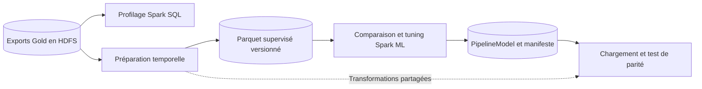

# TrendCast · Analytics et prévision Wikimedia

Ce module prédit les vues du prochain jour calendaire pour un panel de pages technologiques de Wikipédia en anglais. Il réutilise les quatre exports Gold transmis par l’équipe. Les indicateurs Hacker News et Google Trends restent descriptifs. Les traitements utilisent **Spark 3.5.7 en mode distribué** et écrivent leurs résultats dans HDFS.

[Rapport expérimental et résultats de la version hala-20261125-v1](RESULTATS.md)



## Données et périmètre

L’entrée ML est `/trendcast/analytics/ml_dataset`. Le schéma Gold fournit `project`, `page_title`, `event_date`, `views` et `kafka_timestamp`. L’identifiant analytique est `(project, page_title, event_date)`, où `event_date` désigne un jour UTC. Gold n’expose ni la provenance de chaque ligne, ni l’heure de sa première disponibilité, ni les coordonnées Kafka complètes. Les timestamps Kafka servent au diagnostic des imports.

Le panel approuvé comprend les 20 pages configurées dans `.env.example`, du 23 novembre 2025 au 23 novembre 2026 inclus. Cette période offre 366 jours consécutifs de couverture commune. Le profilage porte aussi sur tout Gold afin de documenter les trous, les changements de population et les limites du corpus. L’export utilisé est identifié par son SHA-256 dans les métadonnées du dataset supervisé et du modèle. Les données de consultation proviennent de Wikimedia, dont la page de documentation décrit le filtrage du trafic automatisé.
[Documentation Wikimedia Pageviews](https://wikitech.wikimedia.org/wiki/Analytics/Data/Pageviews)

## Cible et disponibilité des observations

- Pour une date de référence `t`, la date cible est `t+1`, et `target_next_day_views` est la valeur de la même paire projet–page exactement à cette date. La grille des dates de référence est générée indépendamment des valeurs observées.
- Les dates invalides, les identifiants vides et les vues nulles ou négatives sont écartés. À clé identique, plusieurs valeurs égales deviennent une seule observation et des valeurs contradictoires entraînent l’exclusion de la clé. La cible manquante est exclue. Une absence de mesure reste manquante.
- La prévision est destinée à être produite avant minuit UTC ouvrant `t+1`. Le lot quotidien de `t` peut n’être disponible qu’après cette échéance. Le backtest fixe un délai conservateur de deux jours calendaires relativement à `t` et utilise les vues au plus tard de `t−2`. Cette hypothèse peut être réévaluée avec des reçus horodatés réels. La documentation officielle indique qu’un lot peut prendre plusieurs heures, voire au moins 24 heures en cas d’incident. La règle d’inférence exclut aussi toute réception à l’instant de décision ou après.
[Disponibilité des données Wikimedia](https://doc.wikimedia.org/generated-data-platform/aqs/analytics-api/documentation/troubleshooting.html)

## Préparation et expérience

| Élément | Règle |
|---|---|
| Historique | Fenêtre des 28 jours précédant la référence, avec le délai de disponibilité. Une page doit avoir au moins une observation éligible pour recevoir un score. |
| Candidats de base | Dernières vues éligibles, âge en jours de cette observation, sinus et cosinus du jour de semaine de la cible. |
| Candidats enrichis | Jour du mois, mois, week-end, retards calendaires 1/7/14/28, moyennes, écarts-types population et nombres de jours observés sur fenêtres de 7 et 14 jours, variation par rapport à J−7. |
| Fenêtres | Pour un délai de 2, la fenêtre de 7 jours utilise les dates de `t−8` à `t−2`, la fenêtre de 14 jours celles de `t−15` à `t−2`. Les lags exigent la date exacte. |
| Transformations apprises | Les colonnes sans valeur sur train sortent du vecteur. Pour les colonnes restantes avec des manquants, l’imputation est apprise sur train par médiane dans le pipeline. Les fenêtres et le filtrage des réceptions sont déterministes. |
| Variables catégorielles | Projet et titre identifient les séries et le panel. Aucun encodage de ces identifiants dans les variables d’entraînement. |
| Échantillonnage | Découpage d’environ 70/15/15 sur les dates cibles distinctes, dans l’ordre. Une date cible entière appartient à une seule partition. |
| Persistance | Dernières vues éligibles dans la fenêtre. |
| Hebdomadaire | Vues exactes de `date_cible−7` si éligibles. En cas d’absence, la persistance prend le relais pour conserver les mêmes lignes. |
| Modèles | `LinearRegression`, `DecisionTreeRegressor` et `RandomForestRegressor`. Les deux jeux de variables sont comparés sur validation avec les paramètres de départ. |
| Tuning et sélection | La MAE de validation classe les candidats, avec la RMSE pour départager. La meilleure technique est réglée sur la même validation. Le candidat réglé remplace l’initial s’il améliore le classement. Les modèles figés sont comparés sur le test final, sans réapprentissage. |
| Prédictions | Les scores négatifs finis sont ramenés à zéro pour respecter l’unité. La même fonction est utilisée en évaluation et à l’inférence. Une valeur non finie reste nulle et provoque l’échec du contrôle d’évaluation. |

## Reproduction sur Windows

Exécuter depuis la racine de `hala` avec Docker Desktop en conteneurs Linux. Le service `bronze` du profil `jobs` soumet ici des jobs ponctuels via `TRENDCAST_JOB`. Lancer ces commandes lorsque le NameNode est déjà initialisé, ou lors d’un premier démarrage explicitement autorisé sur un volume neuf et vide.

```powershell
docker compose build namenode
docker compose --profile jobs build bronze
docker compose up -d --no-build namenode datanode-1 datanode-2 hdfs-init spark-master spark-worker-1 spark-worker-2
docker compose wait hdfs-init
docker compose exec -T namenode hdfs dfsadmin -report
docker compose exec -T namenode hdfs getconf -confKey dfs.replication
(Invoke-RestMethod 'http://localhost:8080/json/').workers | Select-Object id,state,cores,memory

& './analytics/ml/import_gold.ps1' -Source './shared_data/gold'
```

Le transfert contrôle d’abord les chemins existants. Un dataset déjà présent et identique est réutilisé. Un écart interrompt l’import. Les nouveaux fichiers sont copiés vers un répertoire HDFS temporaire, vérifiés par SHA-256, puis renommés aux emplacements Gold. Le contrôle `fsck` affiche la réplication effective. Les jobs de reconstruction précédents sont inutiles pour ce scénario.

```powershell
$pageLine = Get-Content -LiteralPath '.env.example' | Where-Object { $_ -like 'WIKIMEDIA_PAGES=*' }
$pages = $pageLine.Split('=',2)[1]
$goldHash = (Get-FileHash -Algorithm SHA256 -LiteralPath './shared_data/TrendCast_Gold_Data.zip').Hash.ToLowerInvariant()
$version = 'hala-20261125-v1'
$cluster = 'hdfs://namenode:9000/trendcast'
$profile = "$cluster/analytics/wikimedia_profiles/$version"
$supervised = "$cluster/analytics/wikimedia_supervised/$version"
$model = "$cluster/models/wikimedia_next_day_views/$version"
$scratch = "$cluster/analytics/wikimedia_ml_checks/$version/pipeline"

docker compose --profile jobs run --rm --no-deps -T -e TRENDCAST_JOB=profile_wikimedia.py bronze --pages "$pages" --verify-export --output "$profile"
docker compose --profile jobs run --rm --no-deps -T -e TRENDCAST_JOB=build_supervised_dataset.py bronze --pages "$pages" --start 2025-11-23 --end 2026-11-23 --availability-days 2 --gold-export-sha256 "$goldHash" --version "$version"
docker compose --profile jobs run --rm --no-deps -T -e TRENDCAST_JOB=train_models.py bronze --dataset "$supervised" --version "$version"
docker compose --profile jobs run --rm --no-deps -T -e TRENDCAST_JOB=predict_sample.py bronze --model "$model"
docker compose --profile jobs run --rm --no-deps -T -e TRENDCAST_JOB=check_pipeline.py bronze --scratch-model "$scratch"
```

Choisir un nouveau numéro de version pour une nouvelle écriture. Le dossier HDFS du modèle contient `pipeline/` pour charger le modèle, `manifest/` pour reproduire l’expérience et `test_predictions/` pour l’analyse des erreurs. Les Parquet, modèles et fichiers intermédiaires restent hors Git.

Pour refaire les figures, exporter le profil entier ainsi que `manifest/` et `test_predictions/` du modèle dans deux dossiers locaux sous `.trendcast/`. Utiliser `hdfs dfs -get` dans le conteneur NameNode, puis `docker compose cp` vers Windows. Dans un environnement muni de pandas, pyarrow et matplotlib, lancer le script de tracé.

```powershell
python analytics/ml/plot_report.py --profile .trendcast/export/profile --model-results .trendcast/export/model --output .trendcast/export/figures
```

## Contrat de passation à Nadir

Importer `load_forecaster` et `forecast_for_reference` depuis `analytics.ml.predict_sample`. Fournir la session Spark en UTC, le modèle et son manifeste chargés une seule fois par processus, la date de référence de type Python `date` et, pour un lot, l’historique suivant.

| Entrée | Type Spark | Convention |
|---|---|---|
| `project` | `string` | `en.wikipedia` pour la version courante |
| `page_title` | `string` | Titre canonique avec les mêmes identifiants que Gold |
| `event_date` | `date` | Jour de l’observation en UTC |
| `views` | `long` | Compte de vues positif ou nul |
| `available_at` | `timestamp` | Première disponibilité de cette version de l’observation dans le système de production, en UTC |

Conserver jusqu’à 28 jours d’historique. Les pages hors panel, les pages sans historique éligible et les scores non finis ne produisent pas de ligne. Les observations tardives peuvent alimenter les prévisions ultérieures. Elles n’entrent pas dans une prédiction déjà émise. Le paramètre optionnel `prediction_timestamp` doit être horodaté avec fuseau horaire. Le module refuse une décision à l’échéance UTC ou après. Conserver l’heure de décision réelle.

La sortie est `project:string`, `page_title:string`, `prediction_date:date`, `predicted_views:double`, `model_version:string` et `prediction_timestamp:timestamp`. L’ordre exact du vecteur est dans `selected.features` du manifeste. Les valeurs manquantes sont gérées par le prétraitement sauvegardé et par la règle d’éligibilité du module temporel.

```python
from analytics.ml.predict_sample import forecast_for_reference, load_forecaster

spark.conf.set("spark.sql.session.timeZone", "UTC")
pipeline, manifest = load_forecaster(spark, model_uri)
predictions = forecast_for_reference(
    spark,
    pipeline,
    manifest,
    history,
    reference_date,
    prediction_timestamp=decision_time_utc,
)
```

Pour transférer le modèle, un membre de l’équipe peut exporter le répertoire HDFS versionné `pipeline/` et son `manifest/` avec `hdfs dfs -get`, puis les transférer via un canal privé convenu. Sur l’autre cluster, importer les deux sous le même numéro de version avec `hdfs dfs -put` vers un répertoire neuf et charger son URI. Une réexécution des jobs avec le même export Gold constitue l’autre mode de livraison. Le test de parité sur le cluster d’origine utilise aussi les prédictions du test et l’entrée Gold référencées par le manifeste.

## Questions pour la soutenance

- **Pourquoi exclure les jours sans observation suivante ?** La cible représente les vues d’un jour précis. Il faut un label à `t+1`, ce qu’une ligne à `t+2` ou une absence n’établit pas.
- **Pourquoi limiter le modèle aux 20 pages ?** Le panel est stable et correspond au périmètre prévu pour l’inférence. Les résultats décrivent ces séries et cette période.
- **Pourquoi couper sur la date cible ?** Cela attribue chaque jour à un seul groupe et empêche qu’un label du début de validation soit utilisé en entraînement.
- **Pourquoi deux baselines ?** La persistance mesure la valeur de la dernière observation, et la baseline hebdomadaire mesure une saisonnalité simple. Elles donnent des références concrètes aux trois techniques.
- **Pourquoi expliquer MAE et RMSE ensemble ?** La MAE représente l’erreur absolue moyenne. La RMSE donne davantage de poids aux grosses erreurs, par exemple un pic de visites.
- **Pourquoi conserver l’arbre quand l’hebdomadaire a la meilleure MAE du test ?** L’arbre a été retenu sur validation avant d’observer les scores du test. Sur ce dernier, l’hebdomadaire présente le meilleur écart absolu moyen et l’arbre la meilleure RMSE. Les deux résultats éclairent le choix du service selon le coût des erreurs.
- **Pourquoi séparer le module temporel du pipeline sauvegardé ?** Les features nécessitent un historique daté et ses réceptions. Le modèle sauvegarde ensuite les transformations apprises et la régression.
- **Un bon score permet-il de prédire un nouveau titre ?** L’évaluation suit les mêmes 20 séries au fil du temps. L’admission de nouveaux titres demanderait de mesurer leur couverture et de refaire un test correspondant à cet objectif.
