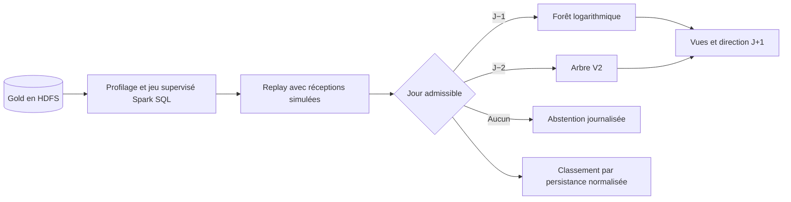

# TrendCast · Analytics et prévision Wikimedia

Ce module prédit les vues du prochain jour calendaire pour un panel de pages technologiques de Wikipédia en anglais. Il intervient après les traitements Gold de TrendCast. HDFS conserve les exports, le jeu supervisé et le modèle. Spark SQL profile les données et construit les features temporelles. Spark MLlib ajuste, compare et sauvegarde les pipelines. Les jobs utilisent **Spark 3.5.7 en mode distribué**. Les indicateurs Hacker News et Google Trends restent descriptifs.

**La politique finale de démonstration et d’intégration est `hala-j1-20261126-v1`.** Entrer par `candidate.py` et suivre la [procédure unique de soutenance](DEMONSTRATION.md).

| Élément | Rôle |
| --- | --- |
| `hala-j1-20261126-v1` | Forêt logarithmique pour les vues et la direction lorsque J−1 est admissible. La direction est calculée à partir du volume prédit, le rang vient de la persistance normalisée. |
| `hala-20261125-v2` | Arbre de décision de secours lorsque seul J−2 est admissible. C’est aussi le modèle officiel actuel de Nadir pendant la validation en parallèle. |
| `hala-20261125-v1` | Ancienne livraison conservée comme référence historique. |
| Brut–log directionnel, forêt multi-âges et autres variantes | Expériences archivées et résultats scientifiques de comparaison. |

Sans total admissible à J−1 ni J−2, le candidat journalise une abstention. L’historique de soutenance utilise des disponibilités simulées. La mise en service de J−1 dépend de la disponibilité réellement mesurée. [Résultats finaux](RESULTATS_CANDIDAT_J1.md) · [Contrat pour Nadir](PASSATION_CANDIDAT_J1.md) · [Critères d’activation](VALIDATION_CANDIDAT_J1.md)



## Données et périmètre

L’entrée ML est `/trendcast/analytics/ml_dataset`. Le schéma Gold fournit `project`, `page_title`, `event_date`, `views` et `kafka_timestamp`. L’identifiant analytique est `(project, page_title, event_date)`, où `event_date` désigne un jour UTC. Gold n’expose ni la provenance de chaque ligne, ni l’heure de sa première disponibilité, ni les coordonnées Kafka complètes. Les timestamps Kafka servent au diagnostic des imports.

Le profilage couvre les 462 056 observations et 56 758 pages de Gold Wikimedia. Le panel d’apprentissage comprend les 20 pages configurées dans `.env.example`, avec 366 jours consécutifs de couverture commune du 23 novembre 2025 au 23 novembre 2026 inclus. Le filtre donne 7 320 observations. La préparation conserve 7 260 lignes supervisées après vérification de la cible et de l’historique. L’empreinte SHA-256 de l’export figure dans les métadonnées du dataset supervisé et du modèle. Les données de consultation proviennent de Wikimedia, dont la page de documentation décrit le filtrage du trafic automatisé.
[Documentation Wikimedia Pageviews](https://wikitech.wikimedia.org/wiki/Analytics/Data/Pageviews)

## Cible et disponibilité des observations

- Pour une date de référence `t`, la date cible est `t+1`, et `target_next_day_views` est la valeur de la même paire projet–page exactement à cette date. La grille des dates de référence est générée indépendamment des valeurs observées.
- Les dates invalides, les identifiants vides et les vues nulles ou négatives sont écartés. À clé identique, plusieurs valeurs égales deviennent une seule observation et des valeurs contradictoires entraînent l’exclusion de la clé. La cible manquante est exclue. Une absence de mesure reste manquante.
- La décision intervient avant minuit UTC ouvrant `t+1`. Le candidat exclut les réceptions à l’instant de décision ou après. Il vérifie qu’un total journalier a été reçu après la clôture du jour source, puis privilégie `t−1` et se replie sur `t−2`. Le Gold actuel ne conserve pas les heures de disponibilité durable. Le cas de soutenance utilise les CSV de replay du ZIP.
[Disponibilité des données Wikimedia](https://doc.wikimedia.org/generated-data-platform/aqs/analytics-api/documentation/troubleshooting.html)

## Historique de préparation et de sélection V1/V2

Les conventions ci-dessous décrivent l’étude qui a produit l’arbre de secours V2. [Rapport expérimental V1/V2](RESULTATS.md)

| Élément | Règle |
|---|---|
| Historique | Fenêtre des 28 jours précédant la référence, avec le délai de disponibilité. Une page doit avoir au moins une observation éligible pour recevoir un score. |
| Candidats de base | Dernières vues éligibles, âge en jours de cette observation, sinus et cosinus du jour de semaine de la cible. |
| Candidats enrichis | Cinq groupes testés par ajout et retrait autour des quatre variables de base. Le détail figure dans [le rapport expérimental](RESULTATS.md). |
| Fenêtres | Pour un délai de 2, la fenêtre de 7 jours utilise `t−8` à `t−2` et celle de 14 jours `t−15` à `t−2`. Les lags exigent leur date exacte. |
| Transformations apprises | La médiane pour imputer les valeurs manquantes et, quand le titre fait partie des features, l’encodage one-hot sont ajustés sur l’entraînement de chaque fenêtre. Le modèle livré utilise les quatre variables de base. |
| Disponibilité des labels | Le backtest situe la première disponibilité d’un label à minuit UTC du jour cible + 2. Chaque ajustement exclut les labels disponibles à partir de la date de début de sa validation. |
| Échantillonnage | Trois validations de 42 jours avec entraînements croissants. Les 1 100 lignes du test historique servent à la comparaison rétrospective après sélection. |
| Persistance | Dernières vues éligibles dans la fenêtre. |
| Hebdomadaire | Vues exactes de `date_cible−7` si éligibles. En cas d’absence, la persistance prend le relais pour conserver les mêmes lignes. |
| Modèles | `LinearRegression`, `DecisionTreeRegressor`, `RandomForestRegressor` et `GBTRegressor`. L’expérience comprend des cibles brute, logarithmique et résiduelle, ainsi que des pondérations avec les baselines. |
| Sélection | Moyenne, sur trois fenêtres, des ratios MAE et RMSE à l’arbre v1 réajusté. Les seuils de promotion prennent aussi en compte la stabilité et le dépassement des références. L’arbre v2 est ensuite réajusté sur les labels disponibles au début de la période rétrospective. |
| Prédictions | Les scores négatifs finis sont ramenés à zéro pour respecter l’unité. La même fonction est utilisée en évaluation et à l’inférence. Une valeur non finie reste nulle et provoque l’échec du contrôle d’évaluation. |

## Reproduction du candidat J1

Le point d’entrée de démonstration est `candidate.py`. Suivre [le parcours de soutenance](DEMONSTRATION.md) pour préparer le cluster, installer les deux modèles, vérifier Gold et exécuter d’abord le scénario **20 routes J−1**, puis le scénario secondaire de robustesse.

La politique se trouve dans HDFS sous `/trendcast/models/wikimedia_next_day_views/candidates/hala-j1-20261126-v1`. Le script `install_final_model.ps1` accepte le ZIP de livraison r2 local, ou `-FromRelease` si la release est publiée et GitHub CLI authentifié. [Installation et traitement des chemins absents](PASSATION_CANDIDAT_J1.md#installation-des-modèles)

L’étude porte sur la prévision de `target_next_day_views` de 20 pages sur 366 jours. Parmi les **40 variables candidates** et quatre familles Spark ML étudiées, les pipelines déployables retiennent `latest_views`, `latest_age`, `weekday_sin` et `weekday_cos` dans cet ordre. Les trois fenêtres chronologiques totalisent **126 jours et 2 520 observations**. La MAE de **1 776,20** est celle de la forêt à J−1 simulé. Le F1 macro de direction est **0,592** et la Precision@5 du classement par persistance **49,52 %**. [Fenêtres, baselines et métriques complètes](RESULTATS_CANDIDAT_J1.md)

### Contrôles hors démonstration

Les tests Python du dépôt se lancent localement. Spark et ses dépendances sont dans l’image TrendCast. Le test distribué figure dans le scénario secondaire de la [démonstration](DEMONSTRATION.md#4-vérifier-la-robustesse-si-le-professeur-le-demande).

```powershell
py -3.13 -m venv .venv
& './.venv/Scripts/python.exe' -m pip install -r ingestion/requirements-automation.txt numpy==2.5.5 pandas==3.1.1
& './.venv/Scripts/python.exe' -m pytest -q --tb=short -p no:cacheprovider
& './.venv/Scripts/ruff.exe' check --no-cache analytics/ml
& './.venv/Scripts/ruff.exe' format --check --no-cache analytics/ml
```

Pour recalculer les sept tableaux, extraire le ZIP r2 dans un dossier distinct puis utiliser son dossier `hala-j1-20261126-v1` comme valeur de `$bundle`. Les 3 620 clés de référence restent dans le ZIP. Le script compare les métriques recalculées aux CSV fournis.

```powershell
$tables = Join-Path 'shared_data' ("recalcul-candidat-" + [guid]::NewGuid().ToString('N'))
& './.venv/Scripts/python.exe' "$bundle/evaluation/recalculer.py" --output "$tables"
```

## Historique de reproduction V2 sur Windows

Exécuter depuis la racine de `hala` avec Docker Desktop en conteneurs Linux. Le service `bronze` du profil `jobs` soumet ici des jobs ponctuels via `TRENDCAST_JOB`. Lancer ces commandes lorsque le NameNode est déjà initialisé, ou lors d’un premier démarrage explicitement autorisé sur un volume neuf et vide.

```powershell
docker compose build namenode
docker compose --profile jobs build bronze
docker compose up -d --no-build namenode datanode-1 datanode-2 hdfs-init spark-master spark-worker-1 spark-worker-2
docker compose wait hdfs-init
docker compose exec -T namenode hdfs dfsadmin -report
docker compose exec -T namenode hdfs getconf -confKey dfs.replication
(Invoke-RestMethod 'http://localhost:8080/json/').workers | Select-Object id,state,cores,memory

& './analytics/ml/import_gold.ps1' -Source './shared_data/gold'
```

Le transfert contrôle d’abord les chemins existants. Un dataset déjà présent et identique est réutilisé. Un écart interrompt l’import. Les nouveaux fichiers sont copiés vers un répertoire HDFS temporaire, vérifiés par SHA-256, puis renommés aux emplacements Gold. Le contrôle `fsck` affiche la réplication effective. Les jobs de reconstruction précédents sont inutiles pour ce scénario.

```powershell
$pageLine = Get-Content -LiteralPath '.env.example' | Where-Object { $_ -like 'WIKIMEDIA_PAGES=*' }
$pages = $pageLine.Split('=',2)[1]
$goldHash = (Get-FileHash -Algorithm SHA256 -LiteralPath './shared_data/TrendCast_Gold_Data.zip').Hash.ToLowerInvariant()
$version = 'hala-20261125-v2-reproduction'
$cluster = 'hdfs://namenode:9000/trendcast'
$profile = "$cluster/analytics/wikimedia_profiles/$version"
$supervised = "$cluster/analytics/wikimedia_supervised/$version"
$model = "$cluster/models/wikimedia_next_day_views/$version"
$scratch = "$cluster/analytics/wikimedia_ml_checks/$version/pipeline"
$referenceV1 = "$cluster/models/wikimedia_next_day_views/hala-20261125-v1"

docker compose --profile jobs run --rm --no-deps -T -e TRENDCAST_JOB=profile_wikimedia.py bronze --pages "$pages" --verify-export --output "$profile"
docker compose --profile jobs run --rm --no-deps -T -e TRENDCAST_JOB=build_supervised_dataset.py bronze --pages "$pages" --start 2025-11-23 --end 2026-11-23 --availability-days 2 --gold-export-sha256 "$goldHash" --version "$version"
docker compose --profile jobs run --rm --no-deps -T -e TRENDCAST_JOB=train_models.py bronze --dataset "$supervised" --version "$version" --retrospective-start 2026-09-30 --reference-model "$referenceV1"
docker compose --profile jobs run --rm --no-deps -T -e TRENDCAST_JOB=predict_sample.py bronze --model "$model"
docker compose --profile jobs run --rm --no-deps -T -e TRENDCAST_JOB=check_pipeline.py bronze --scratch-model "$scratch"
```

Choisir un nouveau numéro de version pour chaque écriture. Réutiliser l’export Gold déjà présent et le profil existant lorsque leurs versions sont connues. La comparaison rétrospective requiert le `test_predictions/` de la v1 et contrôle l’égalité des clés et des labels. Ce Parquet est conservé dans le HDFS de Hala. Le dossier v2 contient `pipeline/`, `manifest/` et `test_predictions/`. Les Parquet et modèles restent hors Git.

Pour refaire les figures, exporter le profil entier ainsi que `manifest/` et `test_predictions/` du modèle dans deux dossiers locaux sous `.trendcast/`. Utiliser `hdfs dfs -get` dans le conteneur NameNode, puis `docker compose cp` vers Windows. Dans un environnement muni de pandas, pyarrow et matplotlib, lancer le script de tracé.

```powershell
python analytics/ml/plot_report.py --profile .trendcast/export/profile --model-results .trendcast/export/model --output .trendcast/export/figures
```

## Évaluation séparée de la V2 figée

Fournir à la préparation (`--input`, `--start`, `--end`) un futur instantané Wikimedia vérifié, avec les mêmes pages et la même définition des vues. Inclure au moins 28 jours de contexte avant la première date de référence évaluée. Produire un dataset supervisé sous un nouvel identifiant, avec le délai de deux jours et l’empreinte de l’instantané. Passer sa racine comme `$newDataset`.

```powershell
$activeModel = "$cluster/models/wikimedia_next_day_views/hala-20261125-v2"
docker compose --profile jobs run --rm --no-deps -T -e TRENDCAST_JOB=train_models.py bronze --dataset "$newDataset" --evaluate-model "$activeModel" --after 2026-11-23
```

`--after` est une borne exclusive. Utiliser une date plus tardive si des observations postérieures ont déjà influencé de nouveaux choix. Le job compare le modèle sauvegardé aux deux baselines et affiche `WIKIMEDIA_FROZEN_EVALUATION`, sans réajustement. Cette évaluation reproduit le délai simulé de Gold. Pour mesurer la couverture réelle du service, conserver aussi les prévisions émises à l’heure de décision et les réceptions `available_at`, puis les rapprocher des labels après disponibilité.

## Contrat historique de la V2 autonome

Le parcours d’intégration final est décrit dans [la passation J−1/J−2](PASSATION_CANDIDAT_J1.md). Les commandes suivantes documentent la V2 autonome, toujours utilisée pour les prévisions officielles pendant la validation du candidat.

Importer `load_forecaster` et `forecast_for_reference` depuis `analytics.ml.predict_sample`. Fournir la session Spark en UTC, le modèle et son manifeste chargés une seule fois par processus, la date de référence de type Python `date` et, pour un lot, l’historique suivant.

| Entrée | Type Spark | Convention |
|---|---|---|
| `project` | `string` | `en.wikipedia` pour la version courante |
| `page_title` | `string` | Titre canonique avec les mêmes identifiants que Gold |
| `event_date` | `date` | Jour de l’observation en UTC |
| `views` | `long` | Compte de vues positif ou nul |
| `available_at` | `timestamp` | Première disponibilité de cette version de l’observation dans le système de production, en UTC |

Conserver jusqu’à 28 jours d’historique. Les pages hors panel, les pages sans historique éligible et les scores non finis ne produisent pas de ligne. Les observations tardives peuvent alimenter les prévisions ultérieures. Elles n’entrent pas dans une prédiction déjà émise. Le paramètre optionnel `prediction_timestamp` doit être horodaté avec fuseau horaire. Le module refuse une décision à l’échéance UTC ou après. Conserver l’heure de décision réelle.

La sortie est `project:string`, `page_title:string`, `prediction_date:date`, `predicted_views:double`, `model_version:string` et `prediction_timestamp:timestamp`. L’ordre exact du vecteur est dans `selected.features` du manifeste. La V2 autonome recherche l’observation précédente dans sa fenêtre éligible. Le candidat applique au préalable les routes strictes J−1 et J−2. Le pipeline V2 assemble les quatre variables sans imputation apprise.

```python
from analytics.ml.predict_sample import forecast_for_reference, load_forecaster

spark.conf.set("spark.sql.session.timeZone", "UTC")
pipeline, manifest = load_forecaster(spark, model_uri)
predictions = forecast_for_reference(
    spark,
    pipeline,
    manifest,
    history,
    reference_date,
    prediction_timestamp=decision_time_utc,
)
```

Pour transférer le modèle, un membre de l’équipe peut exporter le répertoire HDFS versionné `pipeline/` et son `manifest/` avec `hdfs dfs -get`, puis les transférer via un canal privé convenu. Sur l’autre cluster, importer les deux sous le même numéro de version avec `hdfs dfs -put` vers un répertoire neuf et charger son URI. Une réexécution des jobs avec le même export Gold constitue l’autre mode de livraison. Le test de parité sur le cluster d’origine utilise aussi les prédictions du test et l’entrée Gold référencées par le manifeste.

## Questions pour la soutenance

- **Pourquoi exclure les jours sans observation suivante ?** La cible représente les vues d’un jour précis. Il faut un label à `t+1`, ce qu’une ligne à `t+2` ou une absence n’établit pas.
- **Pourquoi limiter le modèle aux 20 pages ?** Le panel est stable et correspond au périmètre prévu pour l’inférence. Les résultats décrivent ces séries et cette période.
- **Pourquoi couper sur la date cible ?** Cela attribue chaque jour à un seul groupe et empêche qu’un label du début de validation soit utilisé en entraînement.
- **Pourquoi deux baselines ?** La persistance mesure la valeur de la dernière observation et l’hebdomadaire mesure une saisonnalité simple. Elles donnent des références concrètes aux quatre techniques Spark ML.
- **Pourquoi expliquer MAE et RMSE ensemble ?** La MAE représente l’erreur absolue moyenne. La RMSE donne davantage de poids aux grosses erreurs, par exemple un pic de visites.
- **Pourquoi deux modèles et un classement distinct ?** J−1 apporte des informations plus fraîches lorsque le reçu est admissible. La V2 fournit une continuité à J−2. La forêt améliore l’erreur de volume et la persistance obtient le meilleur classement sur les mêmes fenêtres historiques.
- **Pourquoi séparer le module temporel du pipeline sauvegardé ?** Les features nécessitent un historique daté et ses réceptions. Le modèle sauvegarde ensuite les transformations apprises et la régression.
- **Un bon score permet-il de prédire un nouveau titre ?** L’évaluation suit les mêmes 20 séries au fil du temps. L’admission de nouveaux titres demanderait de mesurer leur couverture et de refaire un test correspondant à cet objectif.
