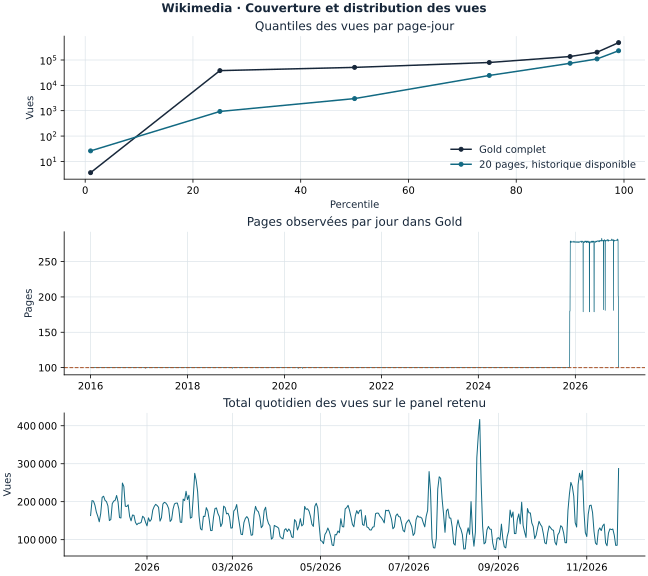
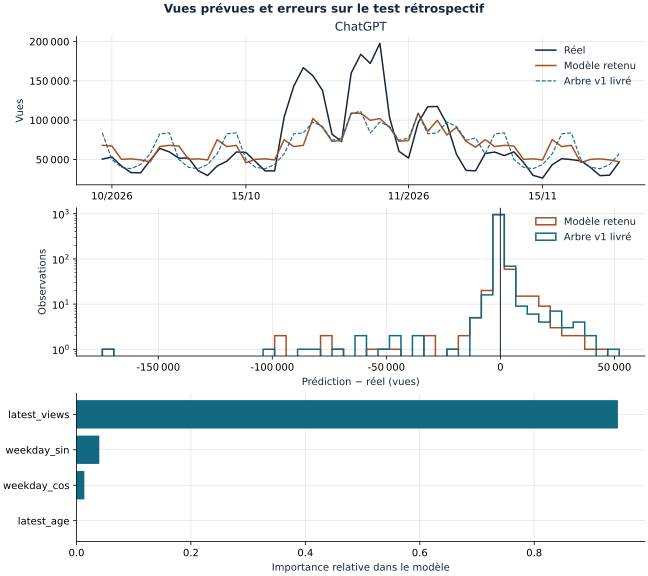

# Résultats expérimentaux · Wikimedia

La première livraison `hala-20261125-v1` et l’optimisation `hala-20261125-v2` utilisent le même export Gold transmis par Soulaimane. Le profilage utilise le corpus complet. L’entraînement et l’évaluation portent sur les 20 pages technologiques approuvées, du 23 novembre 2025 au 23 novembre 2026 inclus. Les commandes, hypothèses et types d’entrée figurent dans le [guide de reproduction et d’inférence](README.md).

## Vérification de l’export et du cluster

L’archive a passé le contrôle CRC et les cinq Parquet locaux lui correspondent octet pour octet. Après transfert, leurs empreintes SHA-256 correspondent dans HDFS. Les cinq blocs ont deux répliques vivantes, une par DataNode. Les quatre chemins sont `HEALTHY`. Le cluster comporte le Master Spark, les deux Workers distincts et le NameNode HDFS demandés. Les trois services HDFS persistent leurs données dans trois volumes distincts. Les journaux Spark confirment l’allocation d’un exécuteur à chacun des deux workers.

| Dataset Gold | Fichiers Parquet lus | Lignes comptées par Spark |
|---|---:|---:|
| ml_dataset | 2 | 462 056 |
| daily_metrics | 1 | 3 977 |
| hackernews_metrics | 1 | 2 |
| google_trends_metrics | 1 | 2 |

HDFS utilise Hadoop 3.4.2 et Java 8u212. Spark utilise la version 3.5.7, Scala 2.12.18, Java 17.0.16 et Python 3.10.12 dans les conteneurs. NumPy 1.26.4 fournit la dépendance Python de Spark ML. Le broker et les traitements d’ingestion ne sont pas requis pour relire les exports remis par l’équipe.

## Profilage Spark SQL

| Indicateur | Gold Wikimedia | 20 titres configurés, toutes dates |
|---|---:|---:|
| Lignes | 462 056 | 9 178 |
| Projets | 1 | 1 |
| Pages | 56 758 | 20 |
| Dates distinctes | 3 977 | 1 983 |
| Première et dernière dates | 2016-01-01 à 2026-11-23 | 2016-01-01 à 2026-11-23 |
| Minimum / maximum des vues | 0 / 17 110 916 | 10 / 1 467 444 |
| Moyenne | 75 550,73 | 23 461,65 |
| P25 / médiane / P75 | 38 076 / 51 084 / 79 645 | 934 / 3 002 / 24 544 |
| P95 / P99 | 202 197 / 483 944 | 110 184 / 231 480 |
| Vues nulles / négatives | 0 / 0 | 0 / 0 |
| Vues égales à zéro | 638 (0,138 %) | 0 |
| Clés de vue dupliquées, identiques ou contradictoires | 0 / 0 | 0 / 0 |
| Séries discontinues | 21 161 | 12 |
| Séries avec moins de 28 observations | 54 171 | 0 |
| Paires de jours consécutifs | 310 234 | 8 894 |
| Intervalles de plus d’un jour | 95 064 | 264 |
| Jours manquants cumulés à l’intérieur des séries | 25 509 545 | 28 884 |
| Délai médian date d’événement → date Kafka | 1 670 jours | 229 jours |

Les quantiles sont des estimations Spark. Dans Gold, la série médiane contient **deux jours observés**. La population quotidienne varie de **99 à 283 pages** et vaut exactement **100** pendant **3 601 jours sur 3 977**. Ce motif est compatible avec une composante de classement quotidien. Le schéma Gold ne permet pas d’attribuer une ligne à un import Top 100, à un autre backfill ou à une collecte récente. Sur l’ensemble, **361 192 événements** ont un Kafka timestamp de plus d’un an après la mesure. Ce décalage motive l’usage de réceptions horodatées en production et d’une hypothèse explicite de disponibilité dans le backtest.

L’API Wikimedia Analytics fournit un accès public aux mesures. La licence et la provenance détaillée ligne par ligne ne figurent pas dans l’export de l’équipe. Les données sources et les fichiers de prédictions restent locaux. [Documentation de l’API Wikimedia](https://doc.wikimedia.org/generated-data-platform/aqs/analytics-api/documentation/getting-started.html)

### Indicateurs descriptifs indépendants

| Date du snapshot | Histoires distinctes Hacker News | Score moyen Hacker News | Commentaires cumulés | Observations Google Trends Maroc | Tendances distinctes |
|---|---:|---:|---:|---:|---:|
| 2026-11-20 | 120 | 224,00 | 24 171 | 20 | 13 |
| 2026-11-24 | 1 108 | 108,89 | 72 877 | 20 | 10 |

Ces deux dates décrivent des snapshots de taille différente. Le nombre de commentaires correspond à l’agrégat Gold des lignes observées. La couverture et le plan de collecte limitent toute comparaison temporelle.

## Préparation du panel

| Étape | Lignes |
|---|---:|
| Gold complet | 462 056 |
| Panel et période, 20 pages × 366 jours | 7 320 |
| Observations valides, après vérification et déduplication | 7 320 |
| Références calendaires entre le premier jour et la veille du dernier label | 7 300 |
| Références sans label exact dans la grille | 0 |
| Références labellisées sans observation historique éligible | 40 |
| **Dataset supervisé** | **7 260** |

Le filtre retient `en.wikipedia`, les 20 titres configurés et les dates du **2025-11-23 au 2026-11-23 inclus**. Il écarte **454 736 lignes** hors périmètre. Les 7 320 lignes restantes sont valides et sans doublon.

L’écart de **60 lignes** entre le panel et le dataset supervisé correspond à deux cas précis. Le **2026-11-23**, les 20 observations servent de labels aux références du 22. Elles ne deviennent pas elles-mêmes des références car l’export s’arrête avant le jour cible du 24. Pour les références du **2025-11-23 et du 2025-11-24**, soit **40 lignes**, la cible existe. L’historique éligible s’arrête à `t−2`, avant le début de la période autorisée. À partir de la référence du 25 novembre, le premier jour observé, le 23, devient éligible.

## Audit du modèle livré v1

La v1 a ajusté ses modèles du 2025-11-26 au 2026-08-06 (5 080 lignes), sélectionné ses paramètres du 2026-08-07 au 2026-09-29 (1 080 lignes) et évalué le résultat sur son test indépendant du 2026-09-30 au 2026-11-23 (1 100 lignes). L’arbre initial utilisait une profondeur de 5, un minimum de 10 observations par nœud et 32 bins. Les trois essais supplémentaires (profondeur, minimum, bins) étaient (3, 15, 32), (7, 5, 32) et (5, 15, 48). Le deuxième avait la meilleure MAE de validation, 2 360,07 vues contre 2 495,58 pour l’arbre initial. La RMSE de validation est passée de 12 949,22 à 12 944,70. La v1 avait déjà testé des variables calendaires, des lags et des statistiques glissantes simples. Ces variables réduisaient la MAE de validation de la régression linéaire et de la forêt. L’arbre fonctionnait mieux avec ses quatre variables de base.

| Technique v1, ancien test | MAE (vues) | RMSE (vues) |
|---|---:|---:|
| Persistance | 2 823,81 | 12 762,44 |
| Hebdomadaire | 2 141,94 | 10 636,73 |
| Régression linéaire | 2 413,40 | 10 720,11 |
| Arbre initial | 2 294,82 | 9 575,17 |
| Forêt aléatoire | 2 427,35 | 10 428,13 |
| Arbre v1 livré | 2 170,20 | 9 557,23 |

L’audit de départ a comparé les 1 100 lignes aux deux baselines. **ChatGPT** représente 55,1 % de la somme des erreurs absolues et 61,3 % de la somme des erreurs au carré. **Google** représente 10,5 % de l’erreur absolue. **Linux** représente 30,3 % de l’erreur au carré. Le biais de ChatGPT est de −3 271 vues en moyenne et celui de Google de +3 406 vues. Les cibles dont le trafic dépasse la médiane historique concentrent 95,5 % de l’erreur absolue. L’hebdomadaire est plus précis que la persistance le samedi et le dimanche. Pour la v1, le biais est positif ces deux jours, et négatif le lundi et le jeudi. La MAE était de 2 127 vues en octobre et 2 211 en novembre. La répartition des 453 sous-estimations et 647 surestimations et le biais moyen de −13,61 vues indiquent que les sous-estimations sont, en moyenne, plus importantes.

Le **2026-11-23**, la valeur Linux dans Gold est de **177 023 vues**, après 2 758, 2 641 et 2 951 vues les trois jours précédents. L’arbre v1 prédit environ 3 074 vues, l’hebdomadaire 7 263 et la persistance 2 758. Le contrôle Gold trouve une clé unique et un compte valide. Les timestamps Kafka correspondent à des réceptions hétérogènes et la provenance par ligne manque. Les données disponibles ne suffisent pas à confirmer la cause du pic. Il est conservé intégralement dans chaque évaluation.

Les **1 858 observations supplémentaires** des mêmes titres précèdent le panel et concernent 12 de ses 20 pages. Leur médiane est de 57 691 vues contre 1 598,5 sur les 366 jours denses. On y trouve des séquences consécutives, mais la couverture change avec le titre et la période. Leur sélection peut dépendre de la popularité, que l’export ne permet pas de mesurer indépendamment. Elles restent dans Gold et sont exclues de l’ajustement. Les deux snapshots Hacker News et Google Trends restent descriptifs.

## Variables et disponibilité temporelle

Pour une référence **t**, le jour cible est **t+1**. La décision précède 00:00 UTC au début du jour cible. Les observations admissibles ont pour date **t−28 à t−2 inclus**. En production, elles doivent aussi satisfaire **available_at < prediction_timestamp**. Gold ne contient pas cet horodatage de première mise à disposition, d’où la simulation documentée de deux jours. Pour l’entraînement, un label est supposé disponible à 00:00 UTC du jour cible +2 et doit l’être strictement avant le début de la fenêtre suivante. Chaque plage utilise des dates civiles UTC et le même panel.

| Position retenue | Variable | Calcul |
|---:|---|---|
| 1 | `latest_views` | Valeur la plus récente qui satisfait les conditions de date et de réception |
| 2 | `latest_age` | Nombre de jours entre sa date d’observation et la référence t |
| 3 | `weekday_sin` | Sinus de 2π × (jour_de_semaine(t+1) − 1) / 7 |
| 4 | `weekday_cos` | Cosinus du même angle. Spark numérote du dimanche 1 au samedi 7 |

Les groupes suivants ont été ajoutés aux quatre variables, d’abord un par un, puis tous ensemble, puis en retirant chaque groupe du jeu complet.

| Groupe | Colonnes et calculs |
|---|---|
| A · Trafic récent | Vues aux dates exactes t−3, t−4, t−7, t−14 et t−28. Nombre de jours mesurés dans la fenêtre éligible. |
| B · Dynamique | Vue(t−2) − vue(t−3) et ce même écart divisé par (1 + vue(t−3)). Moyennes sur 3, 7 et 14 jours calendaires se terminant à t−2. Écarts-types population 7 et 14 jours, minimum, maximum et médiane approximative sur 7 jours. Tendance égale à la moyenne de t−8..t−2 moins celle de t−15..t−9. |
| C · Saisonnalité | Week-end du jour cible, mois du jour cible encodé par sinus et cosinus. Retards exacts de 1 à 4 semaines par rapport à t+1, soit t−6, t−13, t−20, t−27. Moyenne et nombre des retards disponibles. |
| D · Page | Titre appris en one-hot. Moyenne et médiane de t−28..t−2. Écart-type population divisé par (1 + moyenne). Dernières vues divisées par (1 + moyenne). |
| E · Variations inhabituelles | Dernières vues moins moyenne sur 7 jours. Cet écart divisé par (1 + écart-type sur 7 jours), avec un indicateur de dépassement à 2. Différence entre les deux variations successives de t−4 à t−2. Dernières vues divisées par (1 + maximum sur 7 jours). |

Les lags se réfèrent à une date civile exacte. Une date absente reste manquante, et les moyennes portent sur les jours observés dans la plage. L’imputation médiane et l’encodage one-hot sont appris sur l’entraînement propre à chaque fenêtre. Une colonne sans valeur dans une fenêtre sort du vecteur. Après imputation et repli des baselines, tous les candidats ont une couverture de **100 % pour les 840 lignes de chaque validation et les 1 100 lignes rétrospectives**. La périodicité exacte de sept jours manque au début de l’historique, où l’hebdomadaire se replie sur la persistance. La couverture se rapporte au jeu supervisé. Une page sans observation éligible ne reçoit aucun score.

## Sélection chronologique

Les bornes ci-dessous désignent des **dates cibles incluses**. La fenêtre de sélection la plus récente se termine le 27 septembre. Les labels des 28 et 29 septembre ne sont pas encore disponibles avant le cutoff du 30 septembre selon la règle stricte. Le réajustement final emploie 6 120 lignes du 2025-11-26 au 2026-09-27.

| Fenêtre | Entraînement | Lignes | Validation | Lignes |
| --- | --- | --- | --- | --- |
| 1 | 2025-11-26 au 2026-05-22 | 3 560 | 2026-05-25 au 2026-07-05 | 840 |
| 2 | 2025-11-26 au 2026-07-03 | 4 400 | 2026-07-06 au 2026-08-16 | 840 |
| 3 | 2025-11-26 au 2026-08-14 | 5 240 | 2026-08-17 au 2026-09-27 | 840 |

Les **42 essais de criblage** utilisent la troisième fenêtre pour borner le coût. Ils comprennent la configuration v1 réajustée et ses 11 variantes d’ablation, 8 configurations initiales (4 algorithmes × 2 jeux de variables), 12 réglages, 4 transformations de cible et 6 pondérations. La cible `log1p` et le résidu hebdomadaire sont testés sur les deux meilleurs modèles bruts. Les mélanges prennent le meilleur modèle brut et les poids sont criblés dans la même fenêtre. Les prédictions reviennent dans l’unité d’origine, via `expm1` ou en ajoutant la référence hebdomadaire. Les prédictions négatives finies sont ramenées à zéro. Les valeurs cibles Gold restent intégrales. Les estimateurs stochastiques utilisent la graine **345**.

Les neuf finalistes sont évalués sur les trois fenêtres. Pour chaque fenêtre, le score est la moyenne de **MAE candidat / MAE v1 réajustée** et **RMSE candidat / RMSE v1 réajustée**. La règle fixée avant la comparaison avec l’ancien test impose une moyenne des scores **≤ 0,98**, au moins **deux fenêtres améliorées sur trois**, une MAE moyenne au plus égale à la baseline hebdomadaire et une RMSE moyenne au plus égale à l’arbre v1 réajusté. Le banc d’essai inclut la fenêtre de criblage. Ses chiffres mesurent une stabilité historique, avec un risque d’optimisme lié au choix des candidats.

### Ablation et réglages

| Variables ajoutées à la base | MAE | RMSE | Score relatif | Ajustement (s) |
| --- | --- | --- | --- | --- |
| Aucune | 2 591,89 | 14 333,95 | 1,000 | 2,042 |
| A | 2 831,37 | 15 222,19 | 1,077 | 2,806 |
| B | 2 769,39 | 15 408,86 | 1,072 | 2,318 |
| C | 2 975,99 | 16 414,54 | 1,147 | 2,375 |
| D | 2 883,08 | 16 072,47 | 1,117 | 3,243 |
| E | 2 834,58 | 14 960,04 | 1,069 | 2,241 |
| A+B+C+D+E | 2 908,00 | 14 848,23 | 1,079 | 3,678 |
| Jeu complet sans A | 2 916,28 | 14 874,24 | 1,081 | 3,304 |
| Jeu complet sans B | 2 925,99 | 16 116,10 | 1,127 | 3,681 |
| Jeu complet sans C | 2 596,98 | 15 198,25 | 1,031 | 3,724 |
| Jeu complet sans D | 3 166,92 | 16 597,98 | 1,190 | 2,533 |
| Jeu complet sans E | 3 203,08 | 15 363,96 | 1,154 | 2,982 |

Aucun ajout n’améliore le score de l’arbre v1 sur la fenêtre de criblage. Retirer le groupe C donne le jeu enrichi le plus compétitif. Ce jeu est utile à la régression et à la forêt lors du criblage, et augmente le coût de préparation. L’arbre retenu garde les quatre variables de base.

Les paramètres ci-dessous sont ceux explicitement configurés. Les autres gardent les valeurs par défaut de Spark. Les temps d’ajustement et d’évaluation sont des secondes murales observées dans ce job. Les six mélanges réutilisent le modèle brut déjà ajusté.

Voir tous les essais de réglage, de transformation et de mélange

| Essai | Features | Paramètres ou pondérations | MAE | RMSE | Ajust. (s) | Score (s) |
| --- | --- | --- | --- | --- | --- | --- |
| `LinearRegression_core_initial` | `core` | `regParam=0`, `elasticNetParam=0`, `maxIter=50` · raw | 4 126,89 | 19 704,81 | 3,368 | 0,467 |
| `LinearRegression_without_C_initial` | `without_C` | `regParam=0`, `elasticNetParam=0`, `maxIter=50` · raw | 3 594,12 | 16 834,32 | 1,700 | 0,592 |
| `LinearRegression_tune_1` | `without_C` | `regParam=0.01`, `elasticNetParam=0`, `maxIter=60`, `standardization=true` · raw | 3 578,67 | 16 850,79 | 1,556 | 0,640 |
| `LinearRegression_tune_2` | `without_C` | `regParam=0.1`, `elasticNetParam=0.25`, `maxIter=80`, `standardization=true` · raw | 3 391,60 | 15 795,38 | 1,540 | 0,606 |
| `LinearRegression_tune_3` | `without_C` | `regParam=0.1`, `elasticNetParam=0`, `maxIter=50`, `standardization=false` · raw | 3 588,75 | 16 834,92 | 1,411 | 0,587 |
| `DecisionTree_core_initial` | `core` | `maxDepth=5`, `minInstancesPerNode=10`, `maxBins=32` · raw | 2 744,57 | 14 359,41 | 1,111 | 0,429 |
| `DecisionTree_without_C_initial` | `without_C` | `maxDepth=5`, `minInstancesPerNode=10`, `maxBins=32` · raw | 2 839,52 | 15 567,17 | 1,986 | 0,609 |
| `DecisionTree_tune_1` | `core` | `maxDepth=4`, `minInstancesPerNode=12`, `maxBins=32`, `minInfoGain=0` · raw | 2 988,77 | 14 453,31 | 0,803 | 0,392 |
| `DecisionTree_tune_2` | `core` | `maxDepth=7`, `minInstancesPerNode=5`, `maxBins=48`, `minInfoGain=5` · raw | 2 667,17 | 14 705,33 | 1,131 | 0,495 |
| `DecisionTree_tune_3` | `core` | `maxDepth=9`, `minInstancesPerNode=8`, `maxBins=64`, `minInfoGain=25` · raw | 2 541,91 | 14 455,62 | 1,594 | 0,359 |
| `RandomForest_core_initial` | `core` | `numTrees=16`, `maxDepth=5`, `minInstancesPerNode=10` · raw | 3 362,24 | 14 269,40 | 1,180 | 0,488 |
| `RandomForest_without_C_initial` | `without_C` | `numTrees=16`, `maxDepth=5`, `minInstancesPerNode=10` · raw | 2 741,86 | 15 451,43 | 2,583 | 0,567 |
| `RandomForest_tune_1` | `without_C` | `numTrees=12`, `maxDepth=4`, `minInstancesPerNode=15`, `featureSubsetStrategy=sqrt`, `subsamplingRate=0.8` · raw | 2 758,81 | 15 492,51 | 2,346 | 1,450 |
| `RandomForest_tune_2` | `without_C` | `numTrees=24`, `maxDepth=6`, `minInstancesPerNode=8`, `featureSubsetStrategy=onethird`, `subsamplingRate=0.9` · raw | 2 752,95 | 15 404,99 | 2,840 | 0,476 |
| `RandomForest_tune_3` | `without_C` | `numTrees=20`, `maxDepth=7`, `minInstancesPerNode=5`, `featureSubsetStrategy=all`, `subsamplingRate=1` · raw | 2 771,39 | 14 954,39 | 3,345 | 0,577 |
| `GBT_core_initial` | `core` | `maxIter=8`, `maxDepth=3`, `stepSize=0.15`, `minInstancesPerNode=10` · raw | 2 791,63 | 14 326,35 | 3,664 | 0,524 |
| `GBT_without_C_initial` | `without_C` | `maxIter=8`, `maxDepth=3`, `stepSize=0.15`, `minInstancesPerNode=10` · raw | 2 996,37 | 15 586,51 | 7,046 | 0,650 |
| `GBT_tune_1` | `core` | `maxIter=8`, `maxDepth=2`, `stepSize=0.2`, `subsamplingRate=0.85`, `minInstancesPerNode=15`, `maxBins=32` · raw | 3 069,80 | 14 790,81 | 2,311 | 0,378 |
| `GBT_tune_2` | `core` | `maxIter=12`, `maxDepth=3`, `stepSize=0.1`, `subsamplingRate=0.9`, `minInstancesPerNode=10`, `maxBins=48` · raw | 2 900,71 | 14 593,92 | 3,848 | 0,369 |
| `GBT_tune_3` | `core` | `maxIter=10`, `maxDepth=4`, `stepSize=0.15`, `subsamplingRate=1`, `minInstancesPerNode=8`, `maxBins=32` · raw | 2 615,26 | 14 325,98 | 3,889 | 0,375 |
| `DecisionTree_tune_3_log1p` | `core` | `maxDepth=9`, `minInstancesPerNode=8`, `maxBins=64`, `minInfoGain=25` · log1p | 6 771,59 | 21 925,77 | 0,549 | 0,377 |
| `GBT_tune_3_log1p` | `core` | `maxIter=10`, `maxDepth=4`, `stepSize=0.15`, `subsamplingRate=1`, `minInstancesPerNode=8`, `maxBins=32` · log1p | 2 630,96 | 14 716,50 | 3,722 | 0,492 |
| `DecisionTree_tune_3_residual` | `core` | `maxDepth=9`, `minInstancesPerNode=8`, `maxBins=64`, `minInfoGain=25` · residual | 3 594,29 | 22 352,08 | 1,238 | 0,360 |
| `GBT_tune_3_residual` | `core` | `maxIter=10`, `maxDepth=4`, `stepSize=0.15`, `subsamplingRate=1`, `minInstancesPerNode=8`, `maxBins=32` · residual | 3 539,86 | 22 153,00 | 3,885 | 0,471 |
| `weekly_blend_1` | `core` | 25,0 % / 75,0 % / 0,0 % (ML, hebdo, pers.) | 3 010,89 | 18 866,62 | 1,594 | 0,381 |
| `weekly_blend_2` | `core` | 50,0 % / 50,0 % / 0,0 % (ML, hebdo, pers.) | 2 734,33 | 16 563,51 | 1,594 | 0,357 |
| `weekly_blend_3` | `core` | 75,0 % / 25,0 % / 0,0 % (ML, hebdo, pers.) | 2 585,15 | 15 011,83 | 1,594 | 0,403 |
| `three_way_1` | `core` | 25,0 % / 50,0 % / 25,0 % (ML, hebdo, pers.) | 2 885,04 | 17 185,96 | 1,594 | 0,320 |
| `three_way_2` | `core` | 50,0 % / 25,0 % / 25,0 % (ML, hebdo, pers.) | 2 722,70 | 15 825,50 | 1,594 | 0,363 |
| `three_way_3` | `core` | 75,0 % / 12,5 % / 12,5 % (ML, hebdo, pers.) | 2 611,24 | 14 982,59 | 1,594 | 0,349 |

### Résultats des finalistes

Écarts-types population entre fenêtres. Les chiffres restent dans l’unité d’origine.

| Finaliste ou baseline | MAE ± σ | RMSE ± σ | Score ± σ | Fenêtres améliorées |
| --- | --- | --- | --- | --- |
| Persistance | 2 823,14 ± 1 071,13 | 13 273,76 ± 6 790,75 | — | — |
| Hebdomadaire | 2 461,55 ± 1 031,06 | 13 138,21 ± 7 061,29 | — | — |
| Mélange hebdomadaire | 1 968,23 ± 780,98 | 9 850,37 ± 4 902,42 | 0,918 ± 0,133 | 1/3 |
| Mélange à trois | 1 992,07 ± 807,36 | 9 924,83 ± 4 962,40 | 0,923 ± 0,148 | 1/3 |
| Arbre v2 | 2 030,78 ± 726,23 | 9 923,56 ± 4 654,13 | 0,951 ± 0,097 | 2/3 |
| Forêt | 2 073,80 ± 624,13 | 9 908,93 ± 4 317,41 | 0,995 ± 0,063 | 1/3 |
| Arbre v1 réajusté | 2 084,68 ± 634,36 | 9 986,96 ± 4 115,19 | 1,000 ± 0,000 | 0/3 |
| GBT | 2 115,16 ± 635,53 | 9 981,00 ± 4 106,70 | 1,008 ± 0,004 | 0/3 |
| Linéaire | 2 582,42 ± 904,50 | 10 381,98 ± 5 134,04 | 1,099 ± 0,111 | 1/3 |
| GBT log1p | 2 242,97 ± 559,24 | 10 674,48 ± 3 820,84 | 1,105 ± 0,091 | 0/3 |
| GBT résiduel | 2 536,81 ± 1 041,43 | 13 413,49 ± 7 092,00 | 1,217 ± 0,187 | 1/3 |

| Début de fenêtre | MAE / RMSE · v1 réajusté | MAE / RMSE · v2 | MAE / RMSE · mélange hebdomadaire | Score v2 | Score mélange |
| --- | --- | --- | --- | --- | --- |
| 2026-05-25 | 1 190,24 / 4 462,35 | 1 003,74 / 3 523,92 | 866,40 / 3 260,89 | 0,817 | 0,729 |
| 2026-07-06 | 2 471,92 / 11 164,56 | 2 546,70 / 11 791,14 | 2 453,16 / 11 278,39 | 1,043 | 1,001 |
| 2026-08-17 | 2 591,89 / 14 333,95 | 2 541,91 / 14 455,62 | 2 585,15 / 15 011,83 | 0,995 | 1,022 |

**Choix arrêté avant la comparaison rétrospective.** L’arbre brut `DecisionTreeRegressor_tune_3` est le seul candidat qui franchit les seuils. Ses paramètres passent de (7, 5, 32, 0) à **(9, 8, 64, 25)** dans l’ordre profondeur, minimum par nœud, bins et gain d’information minimal. La MAE moyenne baisse de **2,59 %** et la RMSE moyenne de **0,63 %** face à l’arbre v1 réajusté. Il se dégrade dans la deuxième fenêtre. Les deux mélanges gagnent davantage dans la première et améliorent une seule fenêtre chacun. Le modèle de correction hebdomadaire augmente fortement la RMSE moyenne. Le GBT sur log1p abaisse la MAE rétrospective mais augmente la RMSE et sous-estime les vues en moyenne.

## Comparaison rétrospective

Les 1 100 lignes cibles du **2026-09-30 au 2026-11-23** sont les mêmes que lors de la première livraison. Le job vérifie l’égalité des clés et des labels avec le Parquet v1. Cette période a guidé le diagnostic et la conception des expériences. Elle mesure les écarts constatés après la sélection, sans constituer un nouveau test indépendant. L’arbre v1 livré est comparé à la fois à l’arbre v2 et à sa propre configuration réajustée sur les mêmes 6 120 lignes.

| Technique | MAE | RMSE | WAPE | R² | Médiane abs. | P95 abs. | Biais | Couverture |
| --- | --- | --- | --- | --- | --- | --- | --- | --- |
| Persistance | 2 823,81 | 12 762,44 | 39,04 % | 0,558 | 292,00 | 8 346,00 | -60,52 | 100 % |
| Hebdomadaire | 2 141,94 | 10 636,73 | 29,62 % | 0,693 | 133,00 | 5 625,00 | -9,01 | 100 % |
| Arbre v1 livré | 2 170,20 | 9 557,23 | 30,01 % | 0,752 | 234,52 | 7 251,52 | -13,61 | 100 % |
| Arbre v1 réajusté | 2 192,19 | 9 619,45 | 30,31 % | 0,749 | 252,74 | 7 310,26 | -3,02 | 100 % |
| Linéaire | 2 769,33 | 10 891,62 | 38,29 % | 0,678 | 782,19 | 7 831,94 | 68,22 | 100 % |
| Arbre v2 | 2 084,00 | 9 310,54 | 28,82 % | 0,765 | 178,78 | 9 030,55 | -51,21 | 100 % |
| Forêt | 2 228,47 | 9 978,28 | 30,81 % | 0,730 | 148,56 | 10 973,99 | -222,58 | 100 % |
| GBT | 2 228,44 | 9 660,18 | 30,81 % | 0,747 | 221,93 | 7 494,47 | -34,59 | 100 % |
| GBT log1p | 2 056,62 | 10 120,58 | 28,44 % | 0,722 | 174,92 | 5 381,27 | -761,72 | 100 % |
| GBT résiduel | 2 207,72 | 10 675,90 | 30,53 % | 0,691 | 141,11 | 6 431,48 | -156,32 | 100 % |
| Mélange hebdomadaire | 1 937,48 | 9 034,32 | 26,79 % | 0,779 | 156,64 | 8 186,90 | -40,66 | 100 % |
| Mélange à trois | 1 966,81 | 9 166,00 | 27,19 % | 0,772 | 160,89 | 8 403,93 | -47,09 | 100 % |

Face à la v1 livrée, la MAE baisse de **3,97 %**, la RMSE de **2,58 %** et la médiane absolue de **23,77 %**. Face à la persistance, les baisses sont de **26,20 %** en MAE et **27,05 %** en RMSE. Face à l’hebdomadaire, elles sont de **2,71 %** et **12,47 %**. Ces gains sont calculés à partir des métriques non arrondies. Les objectifs MAE < 2 141,94 et RMSE < 9 557,23 sont atteints. Les objectifs de 1 800 et 8 000 restent hors d’atteinte. Le 95e percentile absolu passe de **7 251,52 à 9 030,55 vues**, soit une hausse de **24,53 %**. La précision moyenne s’améliore alors qu’une partie des grandes erreurs s’aggrave.

La MAE mesure l’erreur moyenne en vues. La RMSE pénalise fortement les grands écarts. La WAPE divise la somme des écarts absolus par les vues réellement comptées et reflète davantage les pages populaires. Elle est indéfinie sans trafic observé. Le R² compare à la variance de la cible et peut être négatif sur un segment. La médiane et le p95 Spark sont approximatifs. Les biais sont signés, prévision moins réel. Les erreurs positives et négatives peuvent s’annuler. La couverture est la part des prédictions finies sur le même jeu supervisé.

### Écarts par segment

Le trafic réalisé sert à isoler rétrospectivement les jours les plus fréquentés, avec des seuils à 1 645 et 14 991 vues. Pour mesurer la popularité disponible au moment de la décision, la moyenne des jours t−28 à t−2 définit trois segments, avec des seuils à 1 742,01 et 15 889,95 vues. La volatilité utilise l’écart-type de cette fenêtre divisé par un plus sa moyenne, avec des seuils à 0,1720 et 0,4042. Les seuils correspondent aux quantiles 50 % et 90 % des seules lignes de réajustement. Les segments de popularité ont été calculés séparément sur l’export Gold et les prédictions sauvegardées.

| Segment | Lignes | MAE v1 | MAE v2 | RMSE v2 | Biais v2 | WAPE v2 |
| --- | --- | --- | --- | --- | --- | --- |
| 2026-09 | 20 | 2 582,69 | 1 772,69 | 4 438,79 | 1 179,88 | 25,34 % |
| 2026-10 | 620 | 2 126,89 | 2 100,90 | 9 094,42 | -472,13 | 27,21 % |
| 2026-11 | 460 | 2 210,64 | 2 074,76 | 9 744,74 | 462,60 | 31,51 % |
| Dimanche | 160 | 1 645,21 | 1 344,76 | 4 566,13 | 1 190,84 | 28,14 % |
| Lundi | 160 | 3 085,51 | 3 227,78 | 15 629,87 | -329,22 | 38,28 % |
| Mardi | 140 | 2 638,76 | 2 501,37 | 9 966,28 | -725,95 | 29,20 % |
| Mercredi | 160 | 2 812,89 | 2 272,61 | 10 207,08 | -803,94 | 26,79 % |
| Jeudi | 160 | 1 903,73 | 2 264,42 | 9 409,17 | -774,22 | 26,81 % |
| Vendredi | 160 | 1 706,75 | 1 625,08 | 5 443,16 | 43,27 | 23,10 % |
| Samedi | 160 | 1 457,12 | 1 404,16 | 4 644,32 | 956,43 | 27,79 % |
| Trafic élevé | 143 | 12 893,98 | 12 939,87 | 25 460,72 | -1 290,79 | 32,37 % |
| Trafic faible | 628 | 171,69 | 123,30 | 193,34 | 53,81 | 18,11 % |
| Trafic moyen | 329 | 1 323,88 | 1 108,11 | 2 828,39 | 287,13 | 20,13 % |
| Volatilité élevée | 55 | 16 213,73 | 15 249,38 | 25 846,91 | -360,34 | 33,66 % |
| Volatilité faible | 383 | 1 218,11 | 1 018,96 | 2 474,52 | 319,30 | 17,95 % |
| Volatilité moyenne | 662 | 1 554,27 | 1 606,38 | 9 219,24 | -239,88 | 32,33 % |
| Popularité faible | 653 | 179,74 | 133,54 | 208,91 | 39,92 | 18,28 % |
| Popularité moyenne | 302 | 1 945,92 | 1 830,02 | 10 550,41 | -522,49 | 28,52 % |
| Popularité élevée | 145 | 11 601,25 | 11 396,78 | 20 629,81 | 520,00 | 29,82 % |

La MAE baisse dans les trois segments de popularité. Elle augmente légèrement sur les 143 jours-pages de fort trafic réalisé. Un modèle plus précis en moyenne peut encore manquer les pics les moins prévisibles.

Voir les 20 pages et les résidus

| Segment | Lignes | MAE v1 | MAE v2 | RMSE v2 | Biais v2 | WAPE v2 |
| --- | --- | --- | --- | --- | --- | --- |
| Amazon_(company) | 55 | 687,83 | 691,97 | 995,53 | -127,99 | 11,38 % |
| Artificial_intelligence | 55 | 3 235,26 | 3 755,58 | 5 115,39 | 1 054,09 | 24,07 % |
| Big_data | 55 | 93,28 | 37,75 | 53,05 | -7,09 | 18,59 % |
| Blockchain | 55 | 261,50 | 223,17 | 290,70 | 109,60 | 24,31 % |
| ChatGPT | 55 | 23 896,20 | 23 484,00 | 32 663,44 | -2 133,43 | 33,13 % |
| Cloud_computing | 55 | 275,68 | 246,38 | 349,81 | 99,19 | 22,62 % |
| Data_science | 55 | 96,61 | 65,94 | 79,38 | 11,44 | 27,47 % |
| Deep_learning | 55 | 188,08 | 147,41 | 191,60 | 61,91 | 22,30 % |
| Git | 55 | 280,78 | 147,53 | 178,94 | 61,19 | 14,63 % |
| Google | 55 | 4 575,38 | 3 642,80 | 5 620,02 | 2 299,21 | 18,87 % |
| JavaScript | 55 | 259,25 | 181,04 | 236,92 | -2,54 | 12,63 % |
| Java_(programming_language) | 55 | 241,61 | 180,77 | 260,35 | 90,78 | 15,60 % |
| Linux | 55 | 4 150,81 | 4 190,08 | 23 592,08 | -3 004,52 | 63,21 % |
| Machine_learning | 55 | 303,96 | 237,82 | 318,36 | -2,61 | 15,04 % |
| Microsoft | 55 | 2 607,52 | 2 368,00 | 6 648,18 | 385,45 | 44,91 % |
| NVIDIA | 55 | 48,68 | 39,89 | 85,17 | 11,65 | 68,71 % |
| Natural_language_processing | 55 | 56,74 | 52,81 | 74,53 | 10,74 | 13,96 % |
| Neural_network | 55 | 69,14 | 45,64 | 50,41 | 28,83 | 32,62 % |
| OpenAI | 55 | 1 498,99 | 1 440,81 | 2 446,77 | 40,26 | 17,43 % |
| Python_(programming_language) | 55 | 576,71 | 500,66 | 886,11 | -10,25 | 13,41 % |

La v2 sous-estime 463 cibles et surestime 637 cibles. Le résidu signé médian est de 26,52 vues. Les quantiles approximatifs 1 % et 99 % sont de -28 878,13 et 19 850,00 vues.

Linux le 23 novembre reste le plus grand écart, à **−174 522 vues**. La part de `latest_views` dans l’importance de l’arbre reste élevée, **94,64 %** contre **95,34 %** en v1. `latest_age` conserve sa position et ne produit aucune séparation dans l’arbre v2. Les composantes cycliques représentent environ 5,36 %. De nouvelles données couvrant les chocs réels et des signaux disponibles avant les événements seraient nécessaires pour évaluer une stratégie de prévision de pics. La généralisation à de nouveaux titres reste à étudier sur un panel adapté.

## Artefact, coût et contrôles

Le modèle retenu est **`hala-20261125-v2`**. Il utilise Spark 3.5.7 avec Java 17.0.16, Python 3.10.12 et NumPy 1.26.4. L’expérience distribuée a pris environ **4 minutes**, avec deux exécuteurs d’un cœur chacun. L’ajustement final de l’arbre seul a pris **0,958 s**. Sur les trois validations, la transformation et le calcul des métriques sur 840 lignes déjà préparées ont pris **0,298 à 0,359 s** par fenêtre. La commande de parité après import a pris **51,1 s** pour une journée de 20 pages, en incluant le démarrage Docker et Spark, le chargement depuis HDFS, la préparation et la lecture de référence. Ces mesures ne couvrent pas la latence d’un micro-lot dans le flux de Nadir.

Le [contrat de passation](PASSATION_NADIR.md) décrit l’import et l’usage de la version retenue. L’inférence conserve les cinq champs d’entrée, la même fenêtre d’historique et les quatre mêmes variables du modèle. Le guide contient une [commande d’évaluation future du modèle figé](README.md#évaluation-future-du-modèle-figé). Il reste à la mettre en œuvre sur de nouvelles observations réellement indépendantes et à mesurer la disponibilité effective dans le flux de Nadir.

L’archive v2 a passé le contrôle CRC et le contrôle SHA-256 de ses 11 fichiers référencés. Après import dans un nouveau répertoire HDFS, le pipeline rechargé reproduit **20 prévisions sur 20** pour le 23 novembre, avec un écart absolu maximal de **0,0 vue**. Les 56 tests du dépôt et les contrôles distribués de calendrier, réglage, réceptions et Structured Streaming passent. Le job d’évaluation du modèle figé a bien refusé la borne `--after 2026-11-22`, qui aurait réutilisé une date rétrospective. Le contrôle de streaming utilise un flux Parquet local et `foreachBatch`. Le flux Kafka de Nadir reste à vérifier sur son environnement.
