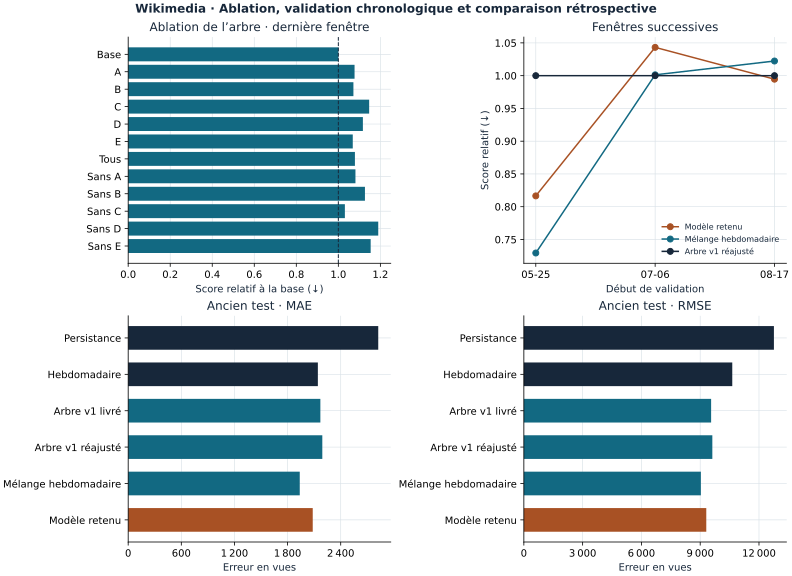

# Résultats expérimentaux · Wikimedia

L’expérience `hala-20261125-v1` utilise l’export Gold transmis par Soulaimane. Le profilage utilise le corpus complet. L’entraînement et l’évaluation portent sur les 20 pages technologiques approuvées, du 23 novembre 2025 au 23 novembre 2026 inclus. Les commandes, hypothèses et types d’entrée figurent dans le [guide de reproduction et d’inférence](README.md).

## Vérification de l’export et du cluster

L’archive a passé le contrôle CRC et les cinq Parquet locaux lui correspondent octet pour octet. Après transfert, leurs empreintes SHA-256 correspondent dans HDFS. Les cinq blocs ont deux répliques vivantes, une par DataNode. Les quatre chemins sont `HEALTHY`. Le cluster comporte le Master Spark, les deux Workers distincts et le NameNode HDFS demandés. Les trois services HDFS persistent leurs données dans trois volumes distincts. Les journaux Spark confirment l’allocation d’un exécuteur à chacun des deux workers.

| Dataset Gold | Fichiers Parquet lus | Lignes comptées par Spark |
|---|---:|---:|
| ml_dataset | 2 | 462 056 |
| daily_metrics | 1 | 3 977 |
| hackernews_metrics | 1 | 2 |
| google_trends_metrics | 1 | 2 |

HDFS utilise Hadoop 3.4.2 et Java 8u212. Spark utilise la version 3.5.7, Scala 2.12.18, Java 17.0.16 et Python 3.10.12 dans les conteneurs. NumPy 1.26.4 fournit la dépendance Python de Spark ML. Le broker et les traitements d’ingestion ne sont pas requis pour relire les exports remis par l’équipe.

## Profilage Spark SQL

| Indicateur | Gold Wikimedia | 20 titres configurés, toutes dates |
|---|---:|---:|
| Lignes | 462 056 | 9 178 |
| Projets | 1 | 1 |
| Pages | 56 758 | 20 |
| Dates distinctes | 3 977 | 1 983 |
| Première et dernière dates | 2016-01-01 à 2026-11-23 | 2016-01-01 à 2026-11-23 |
| Minimum / maximum des vues | 0 / 17 110 916 | 10 / 1 467 444 |
| Moyenne | 75 550,73 | 23 461,65 |
| P25 / médiane / P75 | 38 076 / 51 084 / 79 645 | 934 / 3 002 / 24 544 |
| P95 / P99 | 202 197 / 483 944 | 110 184 / 231 480 |
| Vues nulles / négatives | 0 / 0 | 0 / 0 |
| Vues égales à zéro | 638 (0,138 %) | 0 |
| Clés de vue dupliquées, identiques ou contradictoires | 0 / 0 | 0 / 0 |
| Séries discontinues | 21 161 | 12 |
| Séries avec moins de 28 observations | 54 171 | 0 |
| Paires de jours consécutifs | 310 234 | 8 894 |
| Intervalles de plus d’un jour | 95 064 | 264 |
| Jours manquants cumulés à l’intérieur des séries | 25 509 545 | 28 884 |
| Délai médian date d’événement → date Kafka | 1 670 jours | 229 jours |

Les quantiles sont des estimations Spark. Dans Gold, la série médiane contient **deux jours observés**. La population quotidienne varie de **99 à 283 pages** et vaut exactement **100** pendant **3 601 jours sur 3 977**. Ce motif est compatible avec une composante de classement quotidien. Le schéma Gold ne permet pas d’attribuer une ligne à un import Top 100, à un autre backfill ou à une collecte récente. Sur l’ensemble, **361 192 événements** ont un Kafka timestamp de plus d’un an après la mesure. Ce décalage motive l’usage de réceptions horodatées en production et d’une hypothèse explicite de disponibilité dans le backtest.

L’API Wikimedia Analytics fournit un accès public aux mesures. La licence et la provenance détaillée ligne par ligne ne figurent pas dans l’export de l’équipe. Les données sources et les fichiers de prédictions restent locaux. [Documentation de l’API Wikimedia](https://doc.wikimedia.org/generated-data-platform/aqs/analytics-api/documentation/getting-started.html)

### Indicateurs descriptifs indépendants

| Date du snapshot | Histoires distinctes Hacker News | Score moyen Hacker News | Commentaires cumulés | Observations Google Trends Maroc | Tendances distinctes |
|---|---:|---:|---:|---:|---:|
| 2026-11-20 | 120 | 224,00 | 24 171 | 20 | 13 |
| 2026-11-24 | 1 108 | 108,89 | 72 877 | 20 | 10 |

Ces deux dates décrivent des snapshots de taille différente. Le nombre de commentaires correspond à l’agrégat Gold des lignes observées. La couverture et le plan de collecte limitent toute comparaison temporelle.

## Préparation du panel

| Étape | Lignes |
|---|---:|
| Gold complet | 462 056 |
| Panel et période, 20 pages × 366 jours | 7 320 |
| Observations valides, après vérification et déduplication | 7 320 |
| Références calendaires entre le premier jour et la veille du dernier label | 7 300 |
| Références sans label exact dans la grille | 0 |
| Références labellisées sans observation historique éligible | 40 |
| **Dataset supervisé** | **7 260** |

Le dernier jour observé fournit des labels à la veille. Il ne peut pas devenir une référence supplémentaire sans un label extérieur à la période approuvée. Les deux premiers jours de référence ont une cible, mais aucune observation compatible avec le délai de deux jours dans la fenêtre du panel.

## Découpage chronologique

| Partition | Première date cible | Dernière date cible | Jours | Observations |
|---|---|---|---:|---:|
| Entraînement | 2025-11-26 | 2026-08-06 | 254 | 5 080 |
| Validation | 2026-08-07 | 2026-09-29 | 54 | 1 080 |
| Test final | 2026-09-30 | 2026-11-23 | 55 | 1 100 |

Les vingt séries sont présentes chaque jour éligible. La persistance et la référence hebdomadaire couvrent toutes les lignes de validation et de test. L’hebdomadaire utilise la persistance sur les 80 premières lignes d’entraînement qui n’ont pas encore de valeur à la date cible moins sept jours.

## Comparaison sur validation

Les erreurs sont exprimées en vues. Le temps mesure l’ajustement d’un pipeline sur ce cluster. Chaque ligne de validation compte **1 080 prédictions finies**.

| Technique | Features | MAE | RMSE | Entraînement (s) |
|---|---|---:|---:|---:|
| Persistance | Dernières vues éligibles | 3 480,52 | 18 736,67 | — |
| Hebdomadaire | Date cible moins sept jours | 3 033,40 | 19 412,61 | — |
| Régression linéaire | Base | 3 846,55 | 17 794,44 | 8,476 |
| Régression linéaire | Enrichies | 3 107,30 | 14 574,94 | 3,789 |
| Arbre de décision | Base | 2 495,58 | 12 949,22 | 4,722 |
| Arbre de décision | Enrichies | 3 042,11 | 14 408,90 | 3,600 |
| Forêt aléatoire | Base | 3 107,86 | 12 987,73 | 2,164 |
| Forêt aléatoire | Enrichies | 2 747,57 | 14 235,82 | 2,955 |

La régression linéaire de départ utilise `regParam=0`, `elasticNetParam=0` et `maxIter=50`. La forêt part de 16 arbres, profondeur 5 et 10 observations minimales par nœud. Les variables supplémentaires améliorent la MAE de la régression linéaire et de la forêt. Pour la forêt, elles augmentent aussi la RMSE. L’arbre avec les quatre variables de base obtient la meilleure MAE initiale. Il passe donc au tuning, avec le même jeu de variables et la même validation temporelle.

### Tuning de l’arbre Spark ML

| Configuration | maxDepth | minInstancesPerNode | maxBins | MAE validation | RMSE validation | Entraînement (s) |
|---|---:|---:|---:|---:|---:|---:|
| Départ | 5 | 10 | 32 | 2 495,58 | 12 949,22 | 4,722 |
| Essai 1 | 3 | 15 | 32 | 2 964,93 | 13 310,22 | 1,096 |
| **Essai 2 retenu** | **7** | **5** | **32** | **2 360,07** | **12 944,70** | **2,577** |
| Essai 3 | 5 | 15 | 48 | 2 635,01 | 13 278,12 | 1,914 |

Le réglage réduit la MAE de validation de **5,43 %**. La RMSE reste proche de celle de l’arbre initial. Une fois les paramètres figés, le job évalue les baselines, le meilleur jeu de variables de chacune des trois techniques et l’arbre réglé sur le test indépendant.

## Test final

| Technique | Observations | MAE | RMSE |
|---|---:|---:|---:|
| Persistance | 1 100 | 2 823,81 | 12 762,44 |
| Hebdomadaire | 1 100 | **2 141,94** | 10 636,73 |
| Régression linéaire enrichie | 1 100 | 2 413,40 | 10 720,11 |
| Arbre initial de base | 1 100 | 2 294,82 | 9 575,17 |
| Forêt aléatoire enrichie | 1 100 | 2 427,35 | 10 428,13 |
| **Arbre réglé de base** | **1 100** | **2 170,20** | **9 557,23** |

L’arbre retenu réduit la MAE de **23,15 %** et la RMSE de **25,11 %** face à la persistance. Face à l’hebdomadaire, il réduit la RMSE de **10,15 %**, tandis que sa MAE est supérieure de **1,32 %**. L’hebdomadaire minimise l’erreur absolue moyenne sur cette période. L’arbre sauvegardé réduit davantage le poids des grosses erreurs et reste le candidat sélectionné sur validation. Les deux métriques sont nécessaires pour défendre ce compromis.

### Erreurs, pics et variables

| Segment du test | Observations | MAE | RMSE |
|---|---:|---:|---:|
| Cible ≤ 1 724 vues, médiane d’entraînement | 635 | 172,48 | 250,34 |
| Cible > 1 724 vues | 465 | 4 898,26 | 14 696,56 |

L’erreur absolue médiane est de **234,52 vues**, et le 95e percentile atteint **7 251,52 vues**. Une grande partie du risque se concentre dans les séries à fort trafic et les pics. Par exemple, Linux atteint **177 023 vues** le 23 novembre 2026, pour une prédiction de **3 073,62** et une dernière observation éligible à **2 758 vues**. ChatGPT affiche une MAE de **23 896,20** sur 55 prédictions, et NVIDIA **48,68** sur le même nombre de prédictions. Le modèle repose surtout sur la dernière observation. Un pic sans signal éligible dans l’historique reste difficile à anticiper.

Les dernières vues éligibles représentent **95,34 %** de l’importance dans l’arbre, le sinus hebdomadaire **3,36 %** et son cosinus **1,30 %**. L’âge de la dernière observation a une importance nulle sur ce panel où l’historique est dense. Les résultats décrivent une généralisation aux dates futures du même panel sur la période étudiée. Une disponibilité réelle plus irrégulière, de nouvelles pages ou d’autres périodes nécessitent une évaluation dédiée.

## Modèle, tests et validations

- **Dataset supervisé** à `hdfs://namenode:9000/trendcast/analytics/wikimedia_supervised/hala-20261125-v1`. Le dossier contient le Parquet et son manifeste de préparation.
- **Modèle** à `hdfs://namenode:9000/trendcast/models/wikimedia_next_day_views/hala-20261125-v1`. Le `PipelineModel` sauvegarde l’assemblage et l’arbre. Le vecteur a pour ordre `latest_views`, `latest_age`, `weekday_sin`, `weekday_cos`. Le manifeste conserve l’empreinte de l’archive, les versions logicielles, les dates, les paramètres et les mesures.
- **Rechargement** dans une nouvelle application Spark. Sur le 23 novembre 2026, **20 prédictions sur 20** sont finies et reproduisent les prédictions du test sauvegardé avec un **écart absolu maximal de 0**. Le rejeu utilise la règle de disponibilité du backtest. Les horodatages réels de disponibilité restent à instrumenter côté inférence.
- **Tests Spark distribués** réussis pour le schéma, les doublons, les trous et labels, les lags et fenêtres, l’isolation des séries, la protection temporelle, les splits, les trois entraînements, le tuning sur fixture, le calcul des métriques, la sauvegarde, le rechargement et les observations tardives.
- **Suite existante** de 56 tests réussie. Ruff est vert sur `analytics/ml`. Les cinq écarts du dépôt identifiés avant cette mission subsistent dans les modules Silver et Gold existants.
